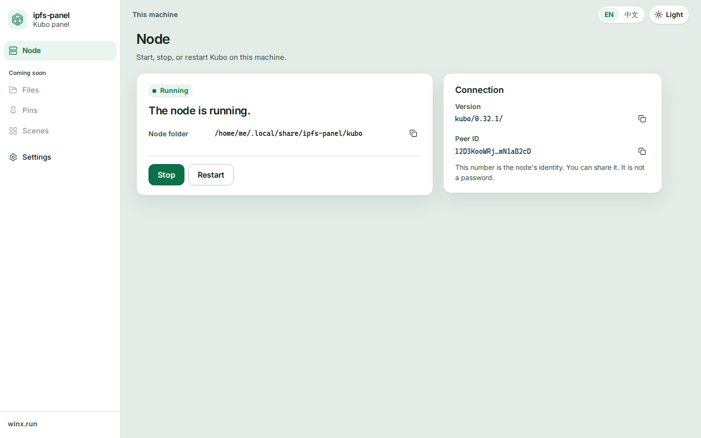
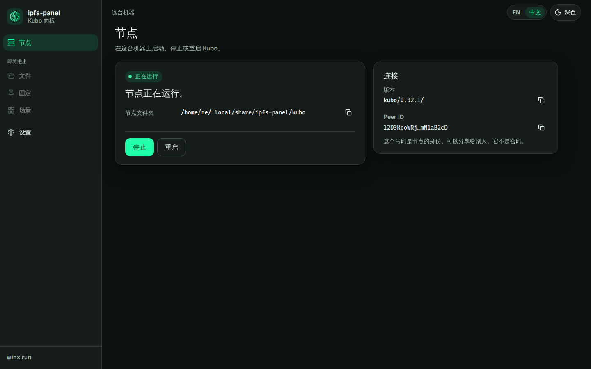
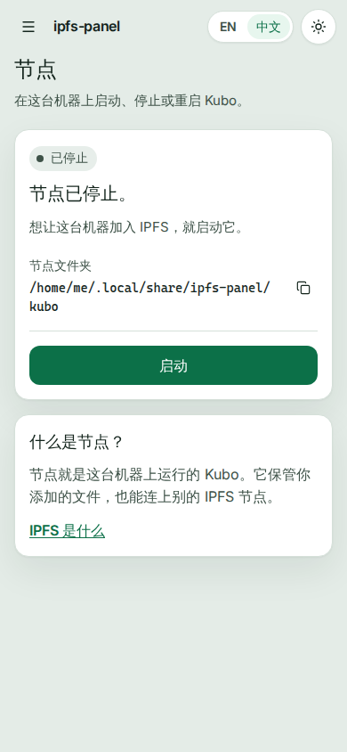
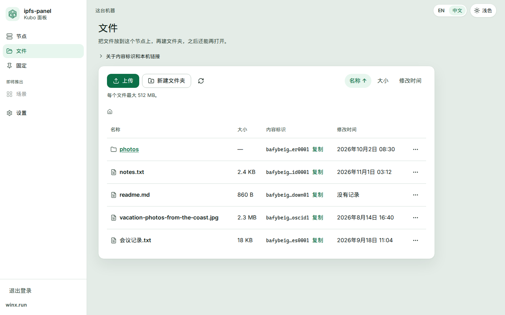
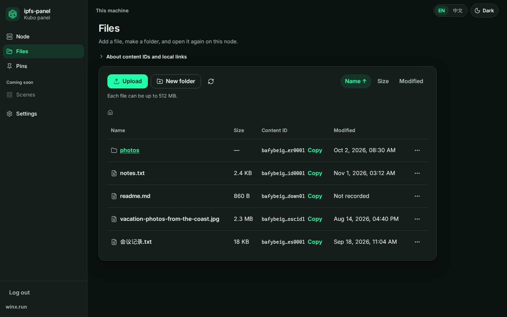
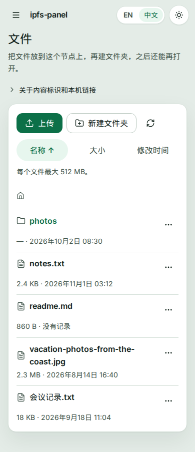
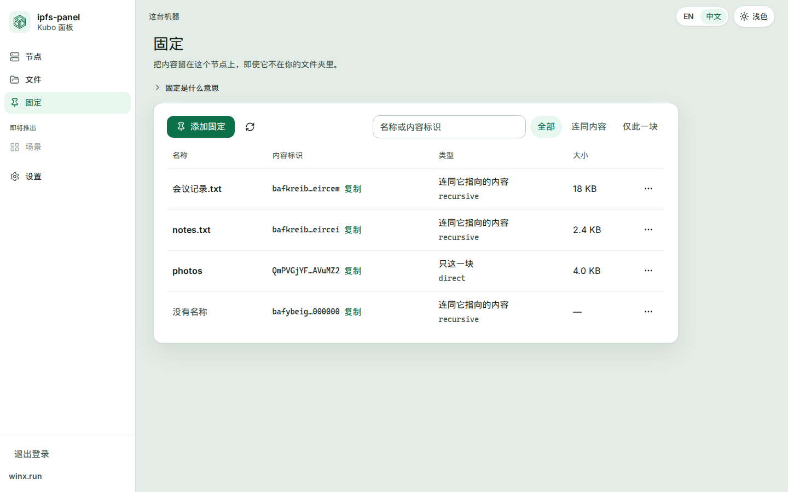
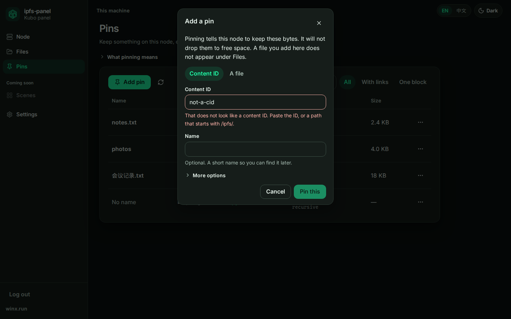

# ipfs-panel

**English** · [中文](README.zh-CN.md)

[](https://github.com/winx-ipfs/ipfs-panel/actions/workflows/ci.yml)

IPFS is worth using. The usual way to run Kubo is not. You get a CLI, a long JSON config, and a local RPC port that must stay private. A lot of people give up before the node feels real.

This repo is a panel for Kubo. Open it on the machine that runs the node, or open it in a browser from somewhere else after you log in. Beginners get a few clear actions. Experts still get the deep settings later, on purpose. This is not a small host panel. No websites, no databases, no "manage the whole server". Kubo is the job.

**winx.run** is the portal. **This repository is the product.**

The browser never talks to Kubo RPC (usually `127.0.0.1:5001`). That port stays on the machine. Our own manager is the API. It checks who you are before it starts or stops Kubo. It binds to loopback unless you override it. Do not publish it until you have read [Auth](docs/design/auth.md).

## Layout

```text
apps/web            the panel UI
services/manager    the API gateway (Go)
docs                why we are building this, and in what order
```

| Path | What lives there |
| --- | --- |
| `apps/web` | Vue 3, Vite, TypeScript, Vue Router, Pinia, vue-i18n. English and 中文 from the first screen. |
| `services/manager` | Go, standard library. The only process that should call Kubo. |
| `docs/VISION.md` | What this is, and what we will not turn it into. |
| `docs/ROADMAP.md` | Vertical slices. Finish one before starting the next. |

## Run the panel

The manager starts and stops one local Kubo. The browser talks to the manager. Kubo (`ipfs`) needs to be on `PATH`, or set `IPFS_PANEL_KUBO_BIN` to the binary. The panel keeps its own repo. The default is `$XDG_DATA_HOME/ipfs-panel/kubo`, or `~/.local/share/ipfs-panel/kubo` when `XDG_DATA_HOME` is unset. It does not use `~/.ipfs`.

Manager:

```bash
cd services/manager
go run ./cmd/manager
curl -s http://127.0.0.1:8080/health
```

You should see `{"status":"ok","service":"manager"}`. That check is the manager process, not Kubo. With `MANAGER_ADDR` unset, the manager listens on `127.0.0.1:8080`. Optional flags: `-addr`, `-repo`, `-data`, `-kubo-bin`, and `-trust-proxy`. Each one overrides the matching environment variable when you pass it.

The first time you open the panel, it asks you to create the admin account. The password is hashed with argon2id and stored in `<data>/auth.json` (mode `0600`), next to the Kubo repo, not inside it. The default data directory is `$XDG_DATA_HOME/ipfs-panel`, or `~/.local/share/ipfs-panel`. After that, the panel asks you to sign in. A request to `/api` without a session is `401`. `GET /health` stays open.

If you forget the password, stop the manager and run `go run ./cmd/manager reset-admin`. It deletes the account. It does not take a password on the command line. Start the manager again and create the account. From another machine, setup also needs the one-time token the new process prints. The reason, and the rest of the rules, are in [Auth](docs/design/auth.md).

UI, in another terminal:

```bash
cd apps/web
npm install
npm run dev
```

Open the printed local URL. The Node card starts, stops, and restarts the node. Files adds, downloads, renames, moves, copies, and deletes files on that node. Pins shows what this node is keeping, lets you pin a content ID or a file, and lets you unpin. The dev server proxies `/api` and `/health` to `http://127.0.0.1:8080`. The largest upload is 512 MiB unless you set `-max-file-bytes` or `IPFS_PANEL_MAX_FILE_BYTES`. A pin that has to be fetched from the network runs in the background for up to 30 minutes (`-pins-timeout` or `IPFS_PANEL_PINS_TIMEOUT`). The rules are in [Files](docs/design/files.md) and [Pins](docs/design/pins.md).

Checks CI runs for the UI:

```bash
cd apps/web
npm ci
npm run lint
npm run typecheck
npm test
npm run build
```

Manager checks:

```bash
cd services/manager
gofmt -l .
go vet ./...
go test -race ./...
go build -o /dev/null ./cmd/manager
```

Node 22 is enough for the UI (22.18 or newer, or Node 24.12+). The manager module needs Go 1.26, which is what `services/manager/go.mod` asks for. CI installs that version.

## Look

The shell, the tokens, and the rules for new screens are in [Design system](docs/DESIGN-SYSTEM.md).

















## Read next

- [Vision](docs/VISION.md)
- [Roadmap](docs/ROADMAP.md)
- [Design system](docs/DESIGN-SYSTEM.md)
- [Auth](docs/design/auth.md)
- [Files](docs/design/files.md)
- [Pins](docs/design/pins.md)
- [Node lifecycle](docs/DESIGN-node-lifecycle.md)
- [Contributing](CONTRIBUTING.md) (Git Flow, CI, hotfixes)
- [Org setup](docs/ORG-SETUP.md) (repository settings checklist)
- [Governance](GOVERNANCE.md)
- [Security](SECURITY.md)
- [Support](SUPPORT.md)
- [Code of conduct](CODE_OF_CONDUCT.md)
- License: [MIT](LICENSE)
