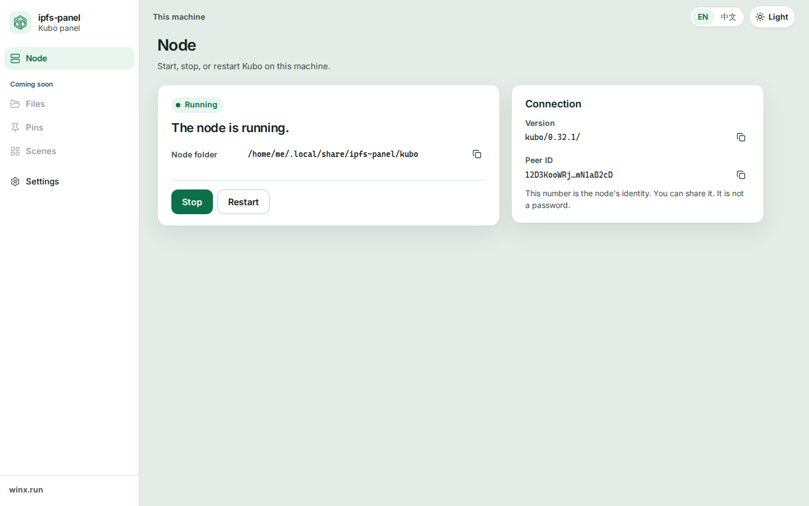
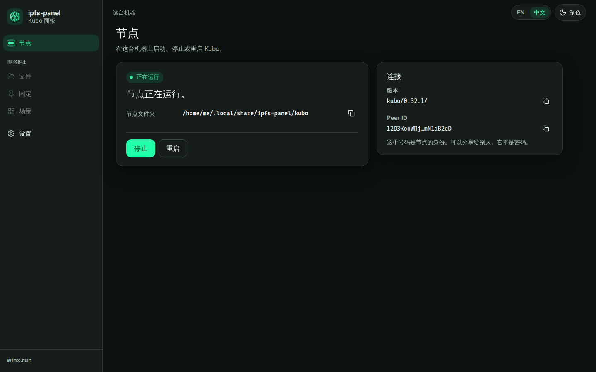
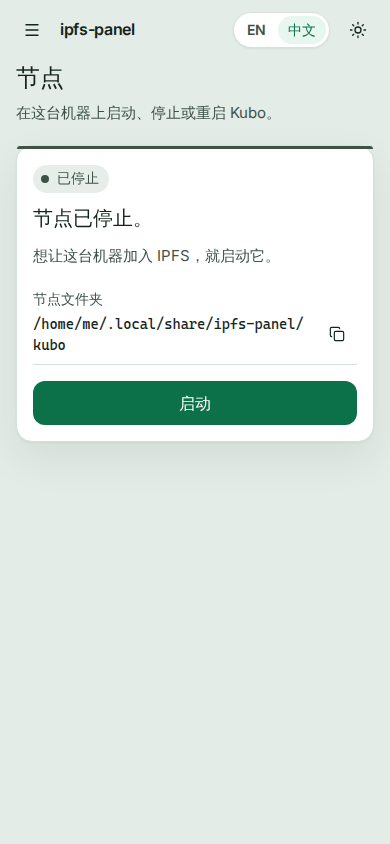
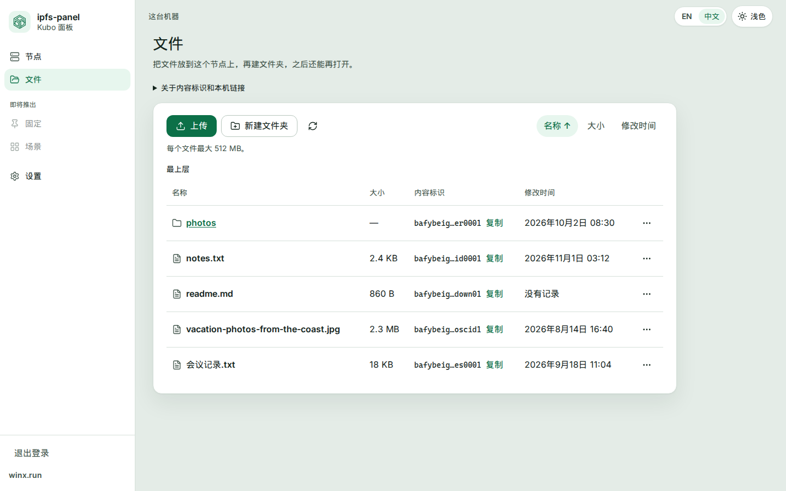
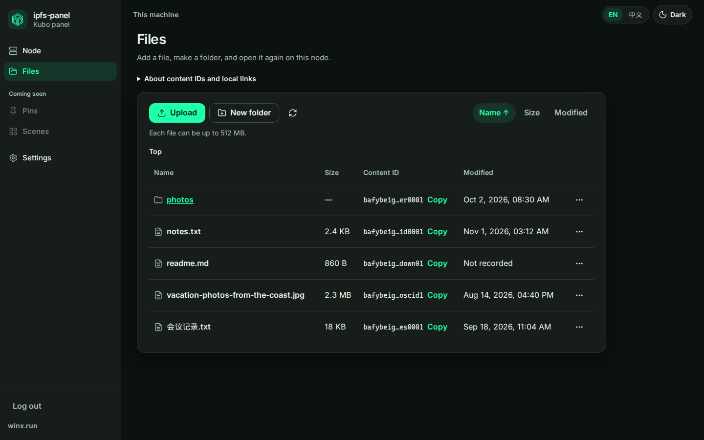
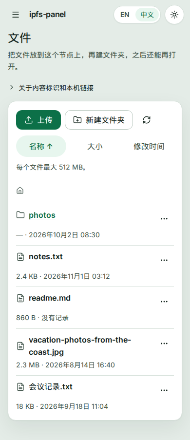
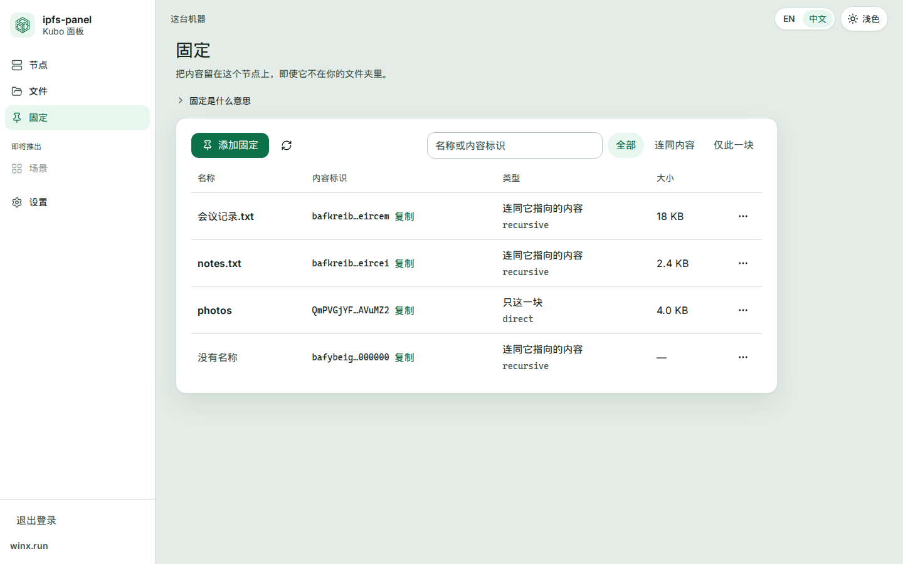
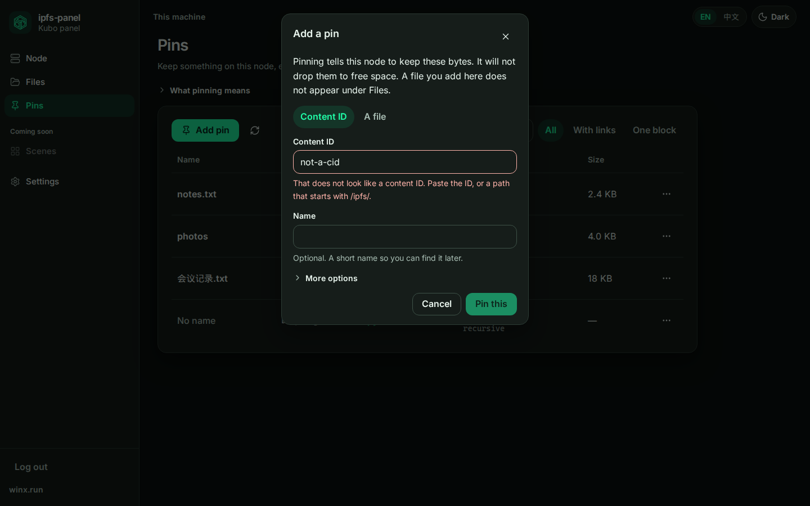

# ipfs-panel

[English](README.md) · **中文**

[](https://github.com/winx-ipfs/ipfs-panel/actions/workflows/ci.yml)

IPFS 值得用。Kubo 默认的用法不太值得折腾。你拿到的是命令行、一份很长的 JSON，还有一个必须留在本机的 RPC 端口。很多人在「节点到底算不算跑起来了」之前就放弃了。

这个仓库是 Kubo 的面板。可以开在跑节点的那台机器上，也可以在别的设备的浏览器里打开，但远程要先登录。新手看到的是几件说得清的事。熟手要的深层设置会晚一点出现，而且是故意晚一点。这不是一个小号的主机面板。不管网站，不管数据库，也不管整台服务器。我们只管 Kubo。

**winx.run** 是门户。**这个仓库才是产品。**

浏览器不和 Kubo RPC 说话（一般是 `127.0.0.1:5001`）。那个端口留在机器上。对外的是我们自己的 manager。它会先确认你是谁，再去启动或停止 Kubo。默认只听本机回环地址。在读过[认证](docs/design/auth.zh-CN.md)之前，别把它暴露出去。

## 目录

```text
apps/web            面板界面
services/manager    API 网关（Go）
docs                为什么做、按什么顺序做
```

| 路径 | 里面是什么 |
| --- | --- |
| `apps/web` | Vue 3、Vite、TypeScript、Vue Router、Pinia、vue-i18n。第一屏就有英文和中文。 |
| `services/manager` | Go，标准库。以后只有这个进程应该去叫 Kubo。 |
| `docs/VISION.md` | 这是什么，以及我们不会把它做成什么。 |
| `docs/ROADMAP.md` | 垂直切片。做完一片再开始下一片。 |

## 把面板跑起来

manager 负责启动和停止本机上的一个 Kubo。浏览器只跟 manager 说话。Kubo（`ipfs`）要在 `PATH` 上，或者用 `IPFS_PANEL_KUBO_BIN` 指向那个二进制。面板用自己的仓库。默认是 `$XDG_DATA_HOME/ipfs-panel/kubo`；没设 `XDG_DATA_HOME` 时是 `~/.local/share/ipfs-panel/kubo`。它不会去用 `~/.ipfs`。

管理服务：

```bash
cd services/manager
go run ./cmd/manager
curl -s http://127.0.0.1:8080/health
```

你应该看到 `{"status":"ok","service":"manager"}`。这个检查只说明 manager 这个进程在，不说明 Kubo 在不在。没设 `MANAGER_ADDR` 时，manager 听在 `127.0.0.1:8080`。可选参数：`-addr`、`-repo`、`-data`、`-kubo-bin`、`-trust-proxy`。传了参数就覆盖对应的环境变量。

第一次打开面板时，它会让你创建管理员账号。密码用 argon2id 哈希，存在 `<data>/auth.json`（权限 `0600`），和 Kubo 仓库并列，不在仓库里面。默认数据目录是 `$XDG_DATA_HOME/ipfs-panel`，没设 `XDG_DATA_HOME` 时是 `~/.local/share/ipfs-panel`。之后面板会要求登录。没有会话的 `/api` 请求是 `401`。`GET /health` 仍然开放。

如果忘了密码，先停掉 manager，再运行 `go run ./cmd/manager reset-admin`。它删掉账号。它不在命令行上接受密码。然后再启动 manager，重新创建账号。从另一台机器设置时，还需要新进程打印的一次性口令。原因和其余规则在[认证](docs/design/auth.zh-CN.md)。

界面，另开一个终端：

```bash
cd apps/web
npm install
npm run dev
```

打开它打印出来的本机地址。节点卡片可以启动、停止和重启节点。文件页可以在这个节点上添加、下载、重命名、移动、复制和删除文件。固定页可以看到这个节点留着什么，可以按内容标识或文件来固定，也可以取消固定。开发服务器把 `/api` 和 `/health` 代理到 `http://127.0.0.1:8080`。单次上传默认最大 512 MiB，可以用 `-max-file-bytes` 或 `IPFS_PANEL_MAX_FILE_BYTES` 改。需要从网络获取的固定在后台跑，最长 30 分钟（`-pins-timeout` 或 `IPFS_PANEL_PINS_TIMEOUT`）。规则在[文件](docs/design/files.zh-CN.md)和[固定](docs/design/pins.zh-CN.md)。

和 CI 一样的界面检查：

```bash
cd apps/web
npm ci
npm run lint
npm run typecheck
npm test
npm run build
```

管理服务的检查：

```bash
cd services/manager
gofmt -l .
go vet ./...
go test -race ./...
go build -o /dev/null ./cmd/manager
```

界面用 Node 22 就行（22.18 或更新，或者 Node 24.12+）。管理服务模块需要 Go 1.26，`services/manager/go.mod` 里写的就是这个版本。CI 会装它。

## 看一眼

外壳、令牌，以及新画面要遵守的规矩，在[设计系统](docs/DESIGN-SYSTEM.zh-CN.md)。

















## 接着读

- [愿景](docs/VISION.zh-CN.md)
- [路线图](docs/ROADMAP.zh-CN.md)
- [设计系统](docs/DESIGN-SYSTEM.zh-CN.md)
- [认证](docs/design/auth.zh-CN.md)
- [文件](docs/design/files.zh-CN.md)
- [固定](docs/design/pins.zh-CN.md)
- [节点启停](docs/DESIGN-node-lifecycle.zh-CN.md)
- [参与方式](CONTRIBUTING.md)（Git Flow、CI、热修）
- [组织设置](docs/ORG-SETUP.zh-CN.md)（仓库设置清单）
- [治理](GOVERNANCE.md)
- [安全](SECURITY.md)
- [支持](SUPPORT.md)
- [行为准则](CODE_OF_CONDUCT.md)
- 许可证：[MIT](LICENSE)
