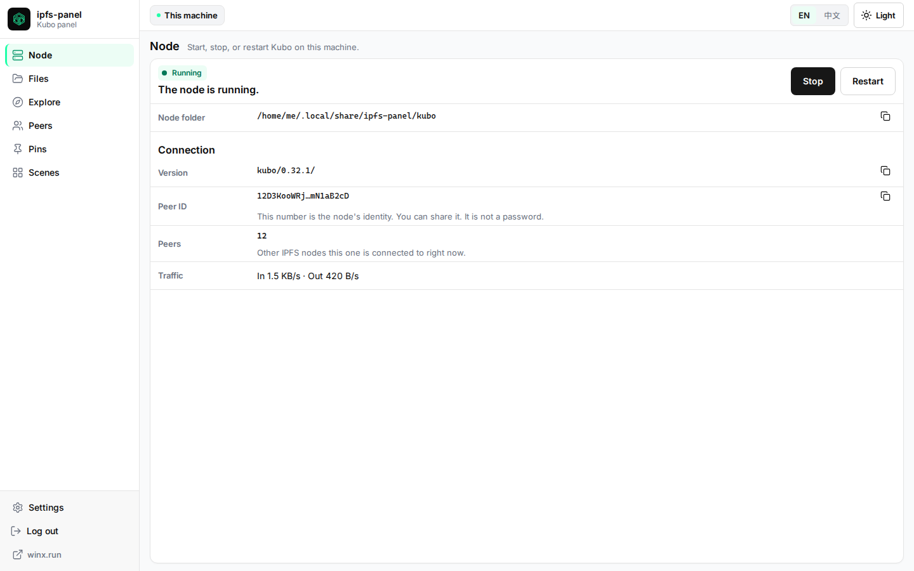
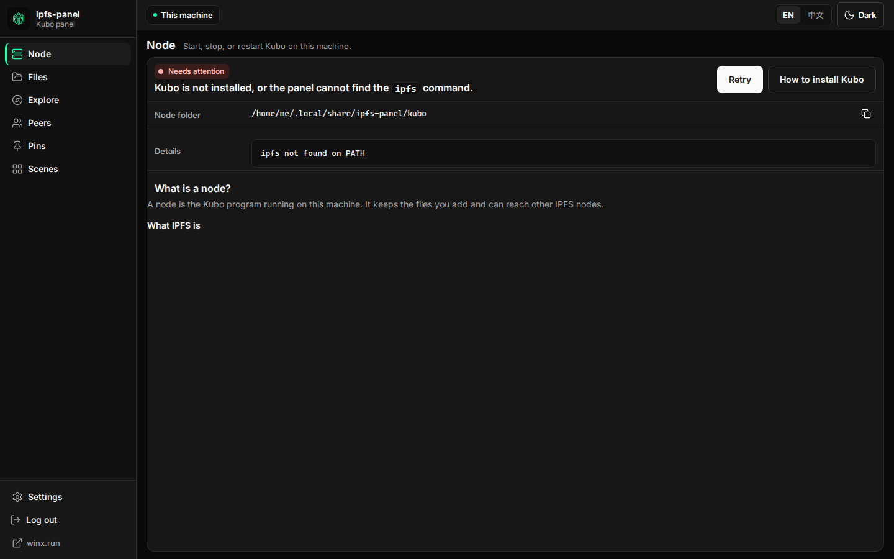

# Design system

**English** · [中文](DESIGN-SYSTEM.zh-CN.md)

This is the visual foundation for **ipfs-panel**. The product name stays ipfs-panel. It sits under the WinX brand. **winx.run** is the front door, not a second product. The node sentences and the manager actions still come from [Node lifecycle](DESIGN-node-lifecycle.md). This file owns the chrome around them.

## What this screen is

A self-hosted open-source ops panel for one Kubo node. Someone installs it and operates the node from a browser. The same UI is the local seat now and the remote seat later. [Vision](VISION.md) already says that. Do not design a second shell for one of them.

The visual language is [winx.run](https://www.winx.run/), not a generic server panel and not the official IPFS webui. Density can be like 1Panel: a toolbar and a tight table. The colors, the type, and the sidebar cannot. Do not copy 宝塔 or 1Panel trademarks, icons, or layout. Do not use their charcoal rail. Do not use IPFS navy `#073A53` or webui teal `#6BC4CE`. Do not wash the page in mint.

What this is not: a SaaS marketing site. No hero, no oversized title, no capsule controls, no card floating in a field of empty color. Beginners still get one sentence and one next step.

## Brand

The mark is the WinX hexagon from [winx-ipfs/Mirror-Web](https://github.com/winx-ipfs/Mirror-Web) `src/assets/winx.svg`, `winx-light.svg`, and `winx-dark.svg`. The in-app mark keeps that geometry and uses `currentColor`, with a heavier stroke so it still reads at 28px. The favicon is a simplified hexagon on `#0A0A0A`, stroked in `#20FFA9`. The full drawing turns to noise at 16px.

`#20FFA9` is firefly green. It is the logo, the selected bar, a pale tint (`#ECFDF5`, and `#CCFBF1` when a step between is needed), and small tags. It is about 1.3:1 on white, so it is never body text and never a button fill. Icon green is `#059669`. Badge text is `#047857` on `#ECFDF5`.

The primary button is black `#171717` with white ink. In the dark theme the same role flips: a near-white button with near-black ink. The quiet button is a white surface with a hairline. Restart stays quiet. Red still means the node needs attention. Running is `#047857` on `#ECFDF5`, a status, not a second brand fill.

## Voice

The page sounds like a tool.

- The `h1` is the section name: Node, Files, Peers. It is not a slogan.
- The line under it is one sentence about the job on this machine. It is not a pitch, and it does not welcome anyone.
- Empty states name the situation and the next action.
- Do not add an eyebrow, a hero line, or a second subtitle.
- Strings that already do this stay. Do not rewrite them for flavor. A new string lands in `en` and `zh` together, and it says the job.

## What we did not adopt

Shared controls are [shadcn-vue](https://shadcn-vue.com/) copied into `apps/web/src/components/ui`, then themed. The style in `components.json` is Nova (`reka-nova`). Rhea is an official style, and it was not used: its default buttons are 16px rounded, which fights the radii below. Product components in `apps/web/src/components` (`Button`, `Card`, `Input`, `Dialog`, `Table`) sit on those primitives. Do not keep a second visual language beside them.

Naive UI, Element Plus, Ant Design Vue, HeroUI, and DaisyUI stay out. [Contributing](../CONTRIBUTING.md) asks for a yes before a new framework. Tailwind, shadcn-vue, and [Motion for Vue](https://motion.dev/docs/vue) (`motion-v`) are that yes. The select stays a native `<select>`, so a phone gets the system picker.

Motion covers a button press, a dialog, a toast, a list entering, and the view change. 150–250ms, ease-out, no bounce and no spring. `prefers-reduced-motion: reduce` sets the duration to zero. Do not add a second motion switch.

Icons are [Lucide](https://lucide.dev) via `@lucide/vue`. Import one icon at a time so the bundle can drop the rest. Default size is 18px, stroke width 1.75. Decorative icons are `aria-hidden`. If an icon is the only content of a button, the button has an accessible name.

Runtime font requests do not go to a CDN. Latin text uses Inter, self-hosted from `@fontsource/inter` (latin 400, 500, 600, woff2). Chinese comes from the machine:

`Inter, Segoe UI, PingFang SC, Hiragino Sans GB, Noto Sans SC, Noto Sans CJK SC, Source Han Sans SC, Microsoft YaHei, WenQuanYi Zen Hei, WenQuanYi Micro Hei, sans-serif`

Mono, for the peer id and the folder path:

`ui-monospace, SFMono-Regular, Cascadia Mono, Sarasa Mono SC, Noto Sans Mono CJK SC, PingFang SC, Microsoft YaHei, monospace`

## Color

Tokens live in `apps/web/src/styles/tokens.css` on `:root`, and again under `:root[data-theme="dark"]`. Names are semantic. Do not use a raw hex in a component. `apps/web/src/stores/theme.ts` and the script in `index.html` copy `--bg` into `theme-color`, because that script runs before CSS.

The light canvas is paper gray. Cards and the sidebar are white. The dark theme is the same roles on layered grays: the page is near black, cards lift one step, and the sidebar sits between them. Green does not paint the canvas.

| Token | Light | Dark | Use |
| --- | --- | --- | --- |
| `--bg` | `#f9fafb` | `#0a0a0a` | Page canvas |
| `--surface` | `#ffffff` | `#171717` | Cards, top bar, dialogs |
| `--surface-sunken` | `#f3f4f6` | `#111111` | Wells, table heads |
| `--border` | `#e5e5e5` | `#2a2a2a` | Hairlines |
| `--border-strong` | `#d4d4d4` | `#3a3a3a` | Inputs, quiet buttons |
| `--text` | `#0a0a0a` | `#fafafa` | Body |
| `--muted` | `#6b7280` | `#a3a3a3` | Secondary text |
| `--primary` | `#171717` | `#fafafa` | Primary buttons. Not green |
| `--primary-ink` | `#ffffff` | `#171717` | Text on a primary button |
| `--primary-soft` | `#ecfdf5` | `rgba(32, 255, 169, 0.12)` | Selected chips and the selected nav wash |
| `--mark` / `--brand` | `#20ffa9` | `#20ffa9` | Logo, selected bar, favicon stroke |
| `--brand-icon` / `--brand-ink` | `#059669` / `#047857` | `#20ffa9` | Icons and badge text on a pale wash |
| `--success` / `--success-soft` | `#047857` / `#ecfdf5` | `#20ffa9` / the pale wash | Running |
| `--warning` / `--warning-soft` | `#8a5a00` / `#fff4d6` | `#f5c16c` / `#3a2c12` | Stopping, unreachable |
| `--danger` / `--danger-soft` | `#b42318` / `#fdecec` | `#ffb4ab` / `#3a1c1a` | Needs attention |
| `--info` / `--info-soft` | `#0f5c86` / `#e7f2f8` | `#9fd4f5` / `#122833` | Starting |
| `--neutral` / `--neutral-soft` | `#6b7280` / `#f3f4f6` | `#d4d4d4` / `#1f1f1f` | Stopped |
| `--sidebar` | `#ffffff` | `#111111` | Rail and the narrow-screen drawer |
| `--sidebar-text` | `#0a0a0a` | `#fafafa` | Rail labels |
| `--sidebar-muted` | `#6b7280` | `#a3a3a3` | Rail secondary text |
| `--sidebar-active` | `#ecfdf5` | the pale wash | Selected section |
| `--sidebar-accent` | `#20ffa9` | `#20ffa9` | The 3px bar on the selected section |

Text and muted text are at least 4.5:1 on `--bg` and `--surface`. Primary button ink is at least 4.5:1 on `--primary`. Badge text is at least 4.5:1 on its wash. `#20FFA9` is not used as text on white.

Text and muted text are at least 4.5:1 on `--bg`, `--surface`, `--surface-sunken`, and the soft fills they sit on. Primary button ink is at least 4.5:1 on `--primary`. The status badge uses the same rule against its soft fill. Rail text and rail muted text are at least 4.5:1 on `--sidebar`, `--sidebar-hover`, and `--sidebar-active`.

Node state colors, always with a word, never color alone:

| Situation | Tone |
| --- | --- |
| `down` | neutral |
| `starting` | info, dot pulses |
| `up` | success |
| `stopping` | warning, dot pulses |
| `failed` | danger |
| manager unreachable | warning |

Stopped is not an error. Stopping is not a failure. The primary button stays black in the light theme and near-white in the dark theme. It is not green, and it is not red. Red means the node needs attention.

## Type, space, radius, shadow, motion

Body text is 14px. That is the size a Chinese ops panel is read at, and Inter at 14px still has a real weight range. Do not drop the body to 12px to look dense.

| Token | Value |
| --- | --- |
| `--text-xs` | 0.75rem (12px) |
| `--text-sm` | 0.8125rem (13px) |
| `--text-md` | 0.875rem (14px) |
| `--text-lg` | 1rem (16px) |
| `--text-xl` | 1rem (16px), a section |
| `--text-2xl` | 1.375rem (22px), the page title, semibold |
| `--leading-body` | 1.571 (22px on 14px) |
| `--space-1` … `--space-12` | 4, 8, 12, 16, 20, 24, 32, 40, 48 |
| `--radius-sm` | 6px, tags |
| `--radius-md` | 8px, buttons and nav items |
| `--radius-field` | 10px, inputs |
| `--radius-lg` | 12px, cards and table containers |
| `--radius-overlay` | 16px, dialogs |
| `--radius-full` | 999px, the switch, the status dot, and the password meter only |
| `--shadow-sm` | a 1px lift on a card |
| `--shadow-md` | a dialog or menu |
| `--duration-fast` / `--duration` | 150ms / 200ms |
| `--ease` | `cubic-bezier(0.2, 0, 0, 1)` |

The page title is 22px semibold. A section title is 16px semibold. Body and table text are 14px with a 22px line height. Captions are 12px. Identifiers (content IDs, peer ids, paths) are 13px monospace. Neither heading uses negative tracking. Under `:lang(zh)` tracking stays 0. Do not tighten Chinese. Do not use Montserrat or IBM Plex Sans as the UI face.

Radii are concentric: the outer control is rounder than the control inside it. One radius for the whole page is wrong. A capsule is wrong. The switch track stays fully rounded because that is the control, not the chrome.

Cards separate from the canvas with a hairline and `--shadow-sm`. They do not float on a large soft shadow. Dialogs and menus use `--shadow-md`.

`prefers-reduced-motion: reduce` cuts animation and transition time to nearly nothing. The pulsing status dot and the skeleton shimmer stop. Do not add a second motion switch. The operating system already has one.

## Density

Tighter than a marketing page, looser than a 2005 control panel.

- Hit targets for actions and icon buttons stay at least 40px. Primary actions on the node card stay 44px tall. Density comes from type, radius, padding, and how much of the workspace the column uses. It does not come from shrinking a button until it is hard to hit.
- Cards pad 16px, 14px on a narrow screen.
- Table rows are 44px. The header row is 36px, uses `--surface-sunken`, and 13px type. It is not uppercase and it is not letter-spaced. Every cell, including the first, has 12px of inline padding, the same inset as the toolbar. A long peer id ellipsizes; the copy control keeps the full id.
- Toolbars are one row. Sort and filter chips use `--radius-md`. The selected chip uses `--primary-soft`.
- Page inset is 20px. Card padding is 16px. The grid is 8px.
- The main column fills the window. Each ops page is a compact title, then one work surface that starts immediately under that title and runs to the bottom of the content area. The list scrolls inside that surface. These pages are a flex column. A grid on the page itself stretches a closed disclosure and shoves the surface down the window. A tall window is not a short card on an empty canvas.
- The node page is one operations surface. A status and action band, then property rows for the folder, version, peer id, peer count, and traffic. When the pins API returns `localGateway`, that address is a row too. The overview still has no API address, and the page does not invent one. The longer explanations sit on the label, so a property row stays one line. Under the rows, a pins section and a connected-peers section use the existing pins and peers APIs, each with a view-all link. From 1100px they sit side by side and end after the last row. Narrower than that, they stack and the page scrolls. The card sizes to that content. It does not stretch empty rows to the window.
- Files, pins, and peers are a toolbar on that same kind of surface, then the list. Connecting a peer is a compact toolbar on the list, not its own tall card.
- In the dark theme the selected nav row is a neutral lift plus the `#20FFA9` bar. It is not a green block. A disabled primary button keeps its fill (black in light, near-white in dark) so it does not fade into gray.
- A form page is `min(920px, 100%)`, left-aligned. A list page (files, pins, peers, explore) and the scenes page are `min(1080px, 100%)`. The node page is one column inside that same width. Prose stays inside about 40rem. The old 760px column left a wide empty field that read as a landing page.

## Components

All of them are in `apps/web/src/components`. Prefer these over a new one-off button.

| Component | Use |
| --- | --- |
| `Button` | `primary` is the one obvious action, black in the light theme. `quiet` is the second action (Restart), white with a hairline. `danger` is rare. `ghost` is a bar action. Radius is 8px. Press scales to 0.98. |
| `IconButton` | Needs a `label`. The label is the accessible name. Pair it with `Tooltip` when the name also helps sighted people. |
| `Card` | One subject on a bordered surface. Status is a `StatusPill`, not a stripe painted on the card. |
| `StatusPill` | A word plus a dot, drawn as a small badge (`--radius-sm`), not a capsule. Tones match the color table. `pulse` only for starting and stopping. |
| `Input` | Label above, hint or error below. Wire `aria-invalid` through the `error` prop. Setup, login, and change-password use it. The node page still must not grow a path field. |
| `Select` | Native select. Two or more options that should use the platform picker. Language on the Settings page. The top bar keeps a two-way segment for English / 中文, because two choices do not need a menu. The segment is rectangular. |
| `Switch` | A boolean the person can flip immediately. Theme "match this device" is the example. The track stays fully rounded. That is the control, not chrome. |
| `Tabs` | Real panels, not a radio by another name. Arrow keys move the tab. Settings uses General, Account, and About. The selected tab is an underline, not a pill. |
| `Dialog` | `dialog` for a short decision, 16px radius. `drawer` for the narrow-screen nav, same surface as the sidebar. Escape closes. Focus returns to the opener. The title is required even when it is visually hidden. Open and close run 200ms. |
| `Toast` | Short confirmation, `aria-live="polite"`. "Copied" is the one we show. Rectangular, not a pill. |
| `Tooltip` | Extra name on hover and focus. Do not hide the only copy of a required sentence in a tooltip. |
| `Skeleton` | The shape of the card while the first overview is in flight. Not a spinner on a blank page. |
| `EmptyState` | A title, one or two sentences, one next step. 404 and a blocked section. The icon tile is 40px with `--radius-sm`. |
| `PageHeader` | One `h1` per page, the section name, plus one sentence about the job. |
| `Table` | Rows of facts or a short record. Put a caption on it. `plain` is for a card. The default is for a record like the About table. Stack the plain table on narrow screens so a peer id is not squeezed into a third column. |
| `BrandMark` | The adapted WinX mark. Do not recolor it outside `--mark` on a surface, or `--sidebar-accent` on the rail. |

Rules:

- One primary button in a group. Restart stays quiet, and only while the node is up.
- Do not invent a sixth node state. Restart is stop, then start.
- Do not show a Kubo RPC address, or port 5001. The files page may copy a local gateway link. The label says it only works on this computer.
- Placeholder sections say they are not built yet, in both languages, and offer a way back to the node. They do not render fake files or fake pins.

## Empty, loading, error

| Moment | What the page does |
| --- | --- |
| First load, no snapshot yet | Skeleton. The status text is "Loading the node status." It is not "The node is stopped." |
| `starting` or `stopping` | The sentence, a hint that the page updates on its own, no manager buttons. |
| `failed` | The translated sentence for `error.code`. `error.detail`, when present, sits in a preformatted well labeled Details. It is not the sentence. |
| Manager request failed | The unreachable sentence, the last snapshot kept, Retry as the only manager action. |
| Section not built | Empty state, Soon in the nav, no disabled item that cannot be opened. |
| Unknown URL | 404 with one action back to the node. The router does not silently redirect. |

## Accessibility

- Body text, muted text, and button ink meet WCAG AA (4.5:1). Focus uses `:focus-visible` so a mouse click does not leave a ring. The ring is a soft `#20FFA9` glow, not a thick outline.
- The first control is "Skip to content".
- The narrow-screen nav is a dialog: labelled, modal, Escape to close, focus trapped, focus restored. It uses the same sidebar surface as the wide rail.
- Tabs use `tab`, `tablist`, and `tabpanel`. The switch uses `role="switch"` and `aria-checked`.
- Status is a sentence in a `role="status"` element, plus the badge. The badge is not the only carrier.
- `html lang` is `en` or `zh-Hans`, from the locale store.
- Hit targets for actions and icon buttons are at least 40px. Primary actions on the node card are 44px tall.

## Layout and the two languages

- A new string lands in `apps/web/src/locales/en.ts` and `zh.ts` in the same change. `zh` is Simplified Chinese.
- Do not ellipsize a sentence, a button label, a peer id, a path, or an error. Wrapping is the layout. A long detail block may scroll inside its well. The text is still in the page.
- Folder paths get a break opportunity after each `/`. Peer ids have no breaks in them, so they wrap anywhere.
- Buttons may grow and wrap onto a second line. Do not fix their width in `ch` of the English word. Chinese labels are often shorter. English hints are often longer.
- The sidebar labels wrap instead of clipping. Node, Files, Explore, Peers, Pins, and Scenes are normal items. Settings sits at the bottom of that list, then the footer.

## Shell

- Sidebar from 880px up, 220px wide. In the light theme it is white, with a hairline on the inline-end edge. It is not charcoal. Below 880px, a menu button opens the drawer.
- The selected section has a `#20FFA9` bar on the inline-start edge and `#ECFDF5` behind the label. Hover is a gray wash, not a capsule.
- The rail does not scroll away on a long page. It stays `100vh`.
- Top bar: a white (or dark-surface) strip with a hairline under it, 48px at rest. It holds "This machine", the English / 中文 segment, and a theme button. The button cycles light, dark, and match-device. Its icon and, from 720px up, its label show the current mode. The accessible name and the tooltip say the same mode. Both choices persist in `localStorage` (`ipfs-panel.lang`, `ipfs-panel.theme`). The theme is applied from a small script in `index.html` before paint, so the first frame is not the wrong theme. The segment and the theme button are rectangular. They do not float as pills.
- The node page is one column. While the node is up, the surface shows the version, a shortened peer id (the copy button copies the full id), the peer count, traffic, and the local gateway when `GET /api/pins` returns `localGateway`. Below that, from 1100px, the current pins and a few connected peers sit side by side and fill the rest of the surface. Narrower than that, they stack and the surface scrolls. Both come from those same APIs, with links to the Pins and Peers pages. The overview has no API address, and the page does not invent one. While the node is stopped, the surface explains what a node is and links to the IPFS docs, and it sizes to that content.
- Nav: Node, Files, Explore, Peers, Pins, Scenes, then Settings. Those are real pages. Expert mode is not a nav item.
- `winx.run` sits in the sidebar footer, under Sign out. It opens in a new tab. It is the portal, labeled as such.
- Login and first-run setup use the same canvas and the same card. There is no glow behind the mark. The mark tile is 48px.

Dev-only, the node page reads `?mock=` when `import.meta.env.DEV` is true: `down`, `starting`, `up`, `stopping`, `failed`, or `unreachable`. The production bundle does not include those fixtures. The Vite proxy to the manager is unchanged.

## Screenshots

From `apps/web`, after `npx playwright install chromium`:

```bash
npm run shots
```

That writes the node page in all five states, the files page (list, empty, uploading, delete dialog, node stopped), the explore page (start, and a block with links), the peers page (list, empty, node stopped), the pins page (list, add dialog with a validation error, a job in progress, empty), the scenes page (list, preview, applied), the setup screen, the login screen with an error, and the settings password form, light and dark, English and 中文, at 1440 and 390, plus the 404 page, to `SHOTS_DIR` or `/opt/cursor/artifacts`. The script starts Vite itself. It does not need a running manager. Auth screens use a dev-only `?auth=` fixture. The files page uses `?files=`. The explore page uses `?explore=`. The peers page uses `?peers=`. The pins page uses `?pins=`. The scenes page uses `?scenes=`. The running node shot also passes `peers=list` and `pins=list`, so the workbench shows those fixtures.

This is not a CI job. A Chromium install and the machine's CJK fonts make a pixel run slow and easy to flake, and `ci-ok` should stay the fast check. The unit tests still cover the sentences, the manager actions, and the form controls. Re-run `npm run shots` when the shell or the node card changes, and look at the pictures.






