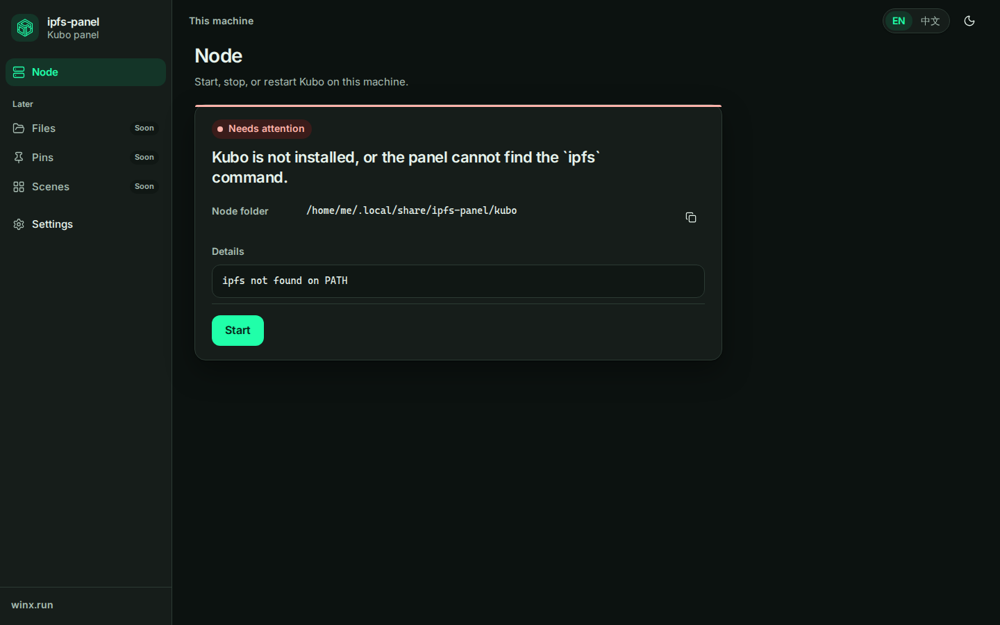
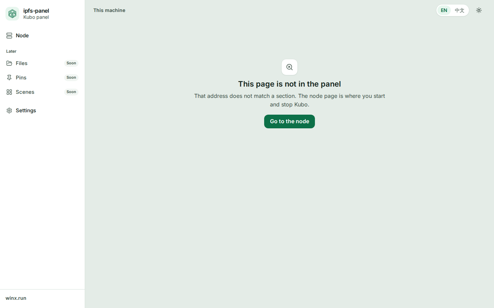

# Design system

English below. 中文在后半部分。

This is the visual foundation for **ipfs-panel**. The product name stays ipfs-panel. It sits under the WinX brand. **winx.run** is the front door, not a second product. The node sentences and the manager actions still come from [Node lifecycle](DESIGN-node-lifecycle.md). This file owns the chrome around them.

## Brand

Calm, plain, and a little green. The references are 1Panel, the Vercel dashboard, Linear, Raycast, and the Tailscale admin: lots of quiet surface, one accent, status you can read without a legend. The people using the first screens include beginners, so the page stays sparse. Density can come later, in expert mode, and not on the home card.

The mark is the WinX hexagon from [winx-ipfs/Mirror-Web](https://github.com/winx-ipfs/Mirror-Web) `src/assets/winx.svg`, `winx-light.svg`, and `winx-dark.svg`. The in-app mark keeps that geometry and uses `currentColor`, with a heavier stroke so it still reads at 28px. The favicon is a simplified hexagon on a dark tile. The full drawing turns to noise at 16px.

The brand green is `#20ffa9`. On a dark surface it is the primary button and the mark. On white it is about 1.3:1, so it is not used for text or buttons in the light theme. Light theme primary is `#0c7048`.

## What we did not adopt

The components are in-house. CSS variables hold the tokens. Vue components in `apps/web/src/components` are thin.

Naive UI and Element Plus were set aside. They ship a second visual language, and a dense admin look, which is the opposite of this page. Restyling them would cost more than drawing the small set we need.

reka-ui (Radix Vue) was the serious alternative. It would have given a focus trap and a listbox. The set here is small enough to own. The select is a native `<select>`, so a phone gets the system picker and a Chinese IME is not our problem. The dialog's focus trap is local. A headless kit stays the escape hatch if a later slice needs a real combobox. It is not a dependency today.

[Contributing](../CONTRIBUTING.md) asks for a yes before a new framework. This change does not add one.

Icons are [Lucide](https://lucide.dev) via `@lucide/vue`. Import one icon at a time so the bundle can drop the rest. Default size is 18px, stroke width 1.75. Decorative icons are `aria-hidden`. If an icon is the only content of a button, the button has an accessible name.

Runtime font requests do not go to a CDN. Latin text uses Inter, self-hosted from `@fontsource/inter` (latin 400, 500, 600, woff2). Chinese comes from the machine:

`Inter, Segoe UI, PingFang SC, Hiragino Sans GB, Noto Sans SC, Noto Sans CJK SC, Source Han Sans SC, Microsoft YaHei, WenQuanYi Zen Hei, WenQuanYi Micro Hei, sans-serif`

Mono, for the peer id and the folder path:

`ui-monospace, SFMono-Regular, Cascadia Mono, Sarasa Mono SC, Noto Sans Mono CJK SC, PingFang SC, Microsoft YaHei, monospace`

## Color

Tokens live in `apps/web/src/styles/tokens.css` on `:root`, and again under `:root[data-theme="dark"]`. Names are semantic. Do not use a raw hex in a component.

| Token | Light | Dark | Use |
| --- | --- | --- | --- |
| `--bg` | `#e4ece7` | `#0c1210` | Page canvas |
| `--surface` | `#ffffff` | `#161d1a` | Cards, sidebar, dialogs |
| `--surface-sunken` | `#f2f6f3` | `#101714` | Wells, details, badges |
| `--border` | `#d5e0d9` | `#2c3b34` | Hairlines |
| `--border-strong` | `#b7c6bd` | `#3e5248` | Inputs, quiet buttons |
| `--text` | `#13241c` | `#e7f3ec` | Body |
| `--muted` | `#3e5248` | `#a8bdb3` | Secondary text |
| `--primary` | `#0c7048` | `#20ffa9` | The one accent, and primary buttons |
| `--primary-ink` | `#ffffff` | `#05281a` | Text on a primary button |
| `--primary-soft` | `#e7f6ee` | `#143528` | Selected nav, soft fills |
| `--success` / `--success-soft` | `#0c7048` / `#e7f6ee` | `#3ee6a4` / `#143528` | Running |
| `--warning` / `--warning-soft` | `#8a5a00` / `#fff4d6` | `#f5c16c` / `#3a2c12` | Stopping, unreachable |
| `--danger` / `--danger-soft` | `#b42318` / `#fdeceb` | `#ffb4ab` / `#3a1c1a` | Needs attention |
| `--info` / `--info-soft` | `#0f5c86` / `#e7f2f8` | `#9fd4f5` / `#122833` | Starting |
| `--neutral` / `--neutral-soft` | `#3e5248` / `#e7eeea` | `#d5e4dc` / `#24302b` | Stopped |
| `--focus` | `#0c7048` | `#20ffa9` | Focus ring |

Text and muted text are at least 4.5:1 on `--bg`, `--surface`, and the soft fills they sit on. Primary button ink is at least 4.5:1 on `--primary`. The status pill uses the same rule against its soft fill.

Node state colors, always with a word, never color alone:

| Situation | Tone |
| --- | --- |
| `down` | neutral |
| `starting` | info, dot pulses |
| `up` | success |
| `stopping` | warning, dot pulses |
| `failed` | danger |
| manager unreachable | warning |

Stopped is not an error. Stopping is not a failure. The primary button stays the accent. It is not red. Red means the node needs attention.

## Type, space, radius, shadow, motion

| Token | Value |
| --- | --- |
| `--text-xs` | 0.75rem |
| `--text-sm` | 0.875rem |
| `--text-md` | 1rem |
| `--text-lg` | 1.125rem |
| `--text-xl` | 1.375rem |
| `--text-2xl` | 1.75rem |
| `--leading-body` | 1.6 |
| `--space-1` … `--space-12` | 4, 8, 12, 16, 20, 24, 32, 40, 48 |
| `--radius-sm` / `md` / `lg` | 8 / 12 / 16 |
| `--radius-full` | 999px |
| `--shadow-sm` | a 1px lift |
| `--shadow-md` | lift plus a soft drop, so a white card separates from the canvas |
| `--duration-fast` / `--duration` | 120ms / 180ms |
| `--ease` | `cubic-bezier(0.2, 0, 0, 1)` |

Latin headings use a slight negative tracking. Under `:lang(zh)` tracking is 0. Do not tighten Chinese.

`prefers-reduced-motion: reduce` cuts animation and transition time to nearly nothing. The pulsing status dot and the skeleton shimmer stop. Do not add a second motion switch. The operating system already has one.

## Components

All of them are in `apps/web/src/components`. Prefer these over a new one-off button.

| Component | Use |
| --- | --- |
| `Button` | `primary` is the one obvious action. `quiet` is the second action (Restart). `danger` is rare and means something hard to undo. `ghost` is for low-emphasis actions in a bar. |
| `IconButton` | Needs a `label`. The label is the accessible name. Pair it with `Tooltip` when the name also helps sighted people. |
| `Card` | One subject. `tone` paints a 3px status bar. `none` is a plain card. |
| `StatusPill` | A word plus a dot. Tones match the color table. `pulse` only for starting and stopping. |
| `Input` | Label above, hint or error below. Wire `aria-invalid` through the `error` prop. Not on a screen yet: the node page must not grow a path field. Login will use it. |
| `Select` | Native select. Two or more options that should use the platform picker. Language on the Settings page. The top bar keeps a two-way segment for English / 中文, because two choices do not need a menu. |
| `Switch` | A boolean the person can flip immediately. Theme "match this device" is the example. |
| `Tabs` | Real panels, not a radio by another name. Arrow keys move the tab. Settings uses General and About. |
| `Dialog` | `dialog` for a short decision. `drawer` for the narrow-screen nav. Escape closes. Focus returns to the opener. The title is required even when it is visually hidden. |
| `Toast` | Short confirmation, `aria-live="polite"`. "Copied" is the one we show. |
| `Tooltip` | Extra name on hover and focus. Do not hide the only copy of a required sentence in a tooltip. |
| `Skeleton` | The shape of the card while the first overview is in flight. Not a spinner on a blank page. |
| `EmptyState` | A title, one or two sentences, one next step. 404 and the placeholder sections. |
| `PageHeader` | One `h1` per page, plus a description that says what the page is for. |
| `Table` | Rows of facts or a short record. Put a caption on it. `plain` is for a card. The default is for a record like the About table. Stack the plain table on narrow screens so a peer id is not squeezed into a third column. |
| `BrandMark` | The adapted WinX mark. Do not recolor it outside `--mark`. |

Rules:

- One primary button in a group. Restart stays quiet, and only while the node is up.
- Do not invent a sixth node state. Restart is stop, then start.
- Do not show ports, a gateway link, or a Kubo RPC address.
- Placeholder sections say they are not built yet, in both languages, and offer a way back to the node. They do not render fake files or fake pins.

## Empty, loading, error

| Moment | What the page does |
| --- | --- |
| First load, no snapshot yet | Skeleton. The status text is "Loading the node status." It is not "The node is stopped." |
| `starting` or `stopping` | The sentence, a hint that the page updates on its own, no manager buttons. |
| `failed` | The translated sentence for `error.code`. `error.detail`, when present, sits in a preformatted well labeled Details. It is not the sentence. |
| Manager request failed | The unreachable sentence, the last snapshot kept, Retry as the only manager action. |
| Section not built | Empty state, Soon in the nav, no disabled item that cannot be opened. |
| Unknown URL | 404 with one action back to the node. The router does not silently redirect. |

## Accessibility

- Body text, muted text, and button ink meet WCAG AA (4.5:1). The focus ring is 2px, offset 2px, and uses `:focus-visible` so a mouse click does not leave a ring.
- The first control is "Skip to content".
- The narrow-screen nav is a dialog: labelled, modal, Escape to close, focus trapped, focus restored.
- Tabs use `tab`, `tablist`, and `tabpanel`. The switch uses `role="switch"` and `aria-checked`.
- Status is a sentence in a `role="status"` element, plus the pill. The pill is not the only carrier.
- `html lang` is `en` or `zh-Hans`, from the locale store.
- Hit targets for actions and icon buttons are at least 40px. Primary actions on the node card are 44px tall.

## Layout and the two languages

- A new string lands in `apps/web/src/locales/en.ts` and `zh.ts` in the same change. `zh` is Simplified Chinese.
- Do not ellipsize a sentence, a button label, a peer id, a path, or an error. Wrapping is the layout. A long detail block may scroll inside its well. The text is still in the page.
- Folder paths get a break opportunity after each `/`. Peer ids have no breaks in them, so they wrap anywhere.
- Buttons may grow and wrap onto a second line. Do not fix their width in `ch` of the English word. Chinese labels are often shorter. English hints are often longer. The column is `min(760px, 100%)` so neither language has a line that runs the full desktop.
- The sidebar labels wrap instead of clipping. Soon badges stay on one short word (`Soon` / `即将`).

## Shell

- Sidebar from 880px up. Below that, a menu button opens the drawer.
- Top bar: English / 中文, and theme. Theme is light, dark, or match the device. Both choices persist in `localStorage` (`ipfs-panel.lang`, `ipfs-panel.theme`). The theme is applied from a small script in `index.html` before paint, so the first frame is not the wrong theme.
- Nav: Node, then Later (Files, Pins, Scenes), then Settings. Expert mode is not a nav item. The vision keeps it off the home page until the common path is dull.
- `winx.run` sits in the sidebar footer. It opens in a new tab. It is the portal, labeled as such.

Dev-only, the node page reads `?mock=` when `import.meta.env.DEV` is true: `down`, `starting`, `up`, `stopping`, `failed`, or `unreachable`. The production bundle does not include those fixtures. The Vite proxy to the manager is unchanged.

## Screenshots

From `apps/web`, after `npx playwright install chromium`:

```bash
npm run shots
```

That writes the node page in all five states, light and dark, English and 中文, at 1440 and 390, plus the 404 page, to `SHOTS_DIR` or `/opt/cursor/artifacts`. The script starts Vite itself. It does not need a running manager.

This is not a CI job. A Chromium install and the machine's CJK fonts make a pixel run slow and easy to flake, and `ci-ok` should stay the fast check. The unit tests still cover the sentences, the manager actions, and the form controls. Re-run `npm run shots` when the shell or the node card changes, and look at the pictures.





---

## 中文

这是 **ipfs-panel** 的视觉地基。产品名仍是 ipfs-panel。它在 WinX 这个牌子下面。**winx.run** 是门口，不是另一个产品。节点的那句话和管理动作仍以[节点启停](DESIGN-node-lifecycle.md)为准。本文管的是周围的界面。

### 品牌

安静、直白、带一点绿。参照是 1Panel、Vercel 的仪表盘、Linear、Raycast、Tailscale 的管理页：大片安静的底，一个强调色，状态不用图例也能读懂。第一批画面的使用者里有新手，所以页面留白。密度以后可以出现在专家模式里，不出现在首页这张卡片上。

标志用的是 WinX 的六边形，来自 [winx-ipfs/Mirror-Web](https://github.com/winx-ipfs/Mirror-Web) 的 `src/assets/winx.svg`、`winx-light.svg`、`winx-dark.svg`。面板里的标志保留这套几何，描边用 `currentColor`，并且加粗，这样 28px 时还看得清。favicon 是深色底上一个简化的六边形。原图缩到 16px 会糊成一团。

品牌绿是 `#20ffa9`。深色底上，它是主按钮，也是标志的颜色。它铺在白底上大约只有 1.3:1，所以浅色主题里不用它做文字或按钮。浅色主题的主色是 `#0c7048`。

### 没有采用的库

组件是自己写的。令牌是 CSS 变量。`apps/web/src/components` 里的 Vue 组件保持薄。

Naive UI 和 Element Plus 先不用。它们自带另一套视觉，而且偏密的管理后台。那和这个页面要的方向相反。为了改掉那套样子，成本比自己画这一小组件更高。

reka-ui（Radix Vue）是认真考虑过的。它能提供焦点圈定和列表框。现在这一组控件很小，自己拿得住。下拉用的是原生 `<select>`，手机上会出系统自己的选择器，中文输入法也不是我们要重做的东西。对话框的焦点圈定写在本地。以后某一片真的需要组合框，无头组件库仍是退路。现在不依赖它。

[参与方式](../CONTRIBUTING.md) 要求新框架先得到同意。这次没有加框架。

图标用 [Lucide](https://lucide.dev)，包是 `@lucide/vue`。一次只引入要用的那个，剩下的才能从包里丢掉。默认 18px，线宽 1.75。装饰性图标加 `aria-hidden`。按钮里只有图标时，按钮要有可访问的名字。

运行时不向 CDN 要字体。拉丁字母用 Inter，从 `@fontsource/inter` 自己带上（latin 的 400、500、600，woff2）。中文用这台机器上的字体：

`Inter, Segoe UI, PingFang SC, Hiragino Sans GB, Noto Sans SC, Noto Sans CJK SC, Source Han Sans SC, Microsoft YaHei, WenQuanYi Zen Hei, WenQuanYi Micro Hei, sans-serif`

等宽字体用来排 Peer ID 和文件夹路径：

`ui-monospace, SFMono-Regular, Cascadia Mono, Sarasa Mono SC, Noto Sans Mono CJK SC, PingFang SC, Microsoft YaHei, monospace`

### 颜色

令牌在 `apps/web/src/styles/tokens.css` 的 `:root` 上，深色在 `:root[data-theme="dark"]`。名字是语义。组件里不要写裸的十六进制。

| 令牌 | 浅色 | 深色 | 用途 |
| --- | --- | --- | --- |
| `--bg` | `#e4ece7` | `#0c1210` | 页面底 |
| `--surface` | `#ffffff` | `#161d1a` | 卡片、侧栏、对话框 |
| `--surface-sunken` | `#f2f6f3` | `#101714` | 下凹的块、详情、徽章 |
| `--border` | `#d5e0d9` | `#2c3b34` | 细线 |
| `--border-strong` | `#b7c6bd` | `#3e5248` | 输入框、次按钮 |
| `--text` | `#13241c` | `#e7f3ec` | 正文 |
| `--muted` | `#3e5248` | `#a8bdb3` | 次要文字 |
| `--primary` | `#0c7048` | `#20ffa9` | 唯一的强调色，以及主按钮 |
| `--primary-ink` | `#ffffff` | `#05281a` | 主按钮上的字 |
| `--primary-soft` | `#e7f6ee` | `#143528` | 选中的导航、浅底 |
| `--success` / `--success-soft` | `#0c7048` / `#e7f6ee` | `#3ee6a4` / `#143528` | 正在运行 |
| `--warning` / `--warning-soft` | `#8a5a00` / `#fff4d6` | `#f5c16c` / `#3a2c12` | 正在停止、连不上 |
| `--danger` / `--danger-soft` | `#b42318` / `#fdeceb` | `#ffb4ab` / `#3a1c1a` | 需要处理 |
| `--info` / `--info-soft` | `#0f5c86` / `#e7f2f8` | `#9fd4f5` / `#122833` | 正在启动 |
| `--neutral` / `--neutral-soft` | `#3e5248` / `#e7eeea` | `#d5e4dc` / `#24302b` | 已停止 |
| `--focus` | `#0c7048` | `#20ffa9` | 焦点环 |

正文和次要文字在 `--bg`、`--surface` 以及它们所在的浅底上至少 4.5:1。主按钮的字在 `--primary` 上至少 4.5:1。状态胶囊和它的浅底也按这条。

节点状态的颜色永远配一个词，不能只靠颜色：

| 情况 | 色调 |
| --- | --- |
| `down` | 中性 |
| `starting` | 信息色，圆点会轻跳 |
| `up` | 成功 |
| `stopping` | 警告，圆点会轻跳 |
| `failed` | 危险 |
| 连不上管理服务 | 警告 |

已停止不是错误。正在停止也不是失败。主按钮保持强调色，不用红色。红色表示节点需要处理。

### 字号、间距、圆角、阴影、动效

| 令牌 | 值 |
| --- | --- |
| `--text-xs` | 0.75rem |
| `--text-sm` | 0.875rem |
| `--text-md` | 1rem |
| `--text-lg` | 1.125rem |
| `--text-xl` | 1.375rem |
| `--text-2xl` | 1.75rem |
| `--leading-body` | 1.6 |
| `--space-1` … `--space-12` | 4、8、12、16、20、24、32、40、48 |
| `--radius-sm` / `md` / `lg` | 8 / 12 / 16 |
| `--radius-full` | 999px |
| `--shadow-sm` | 1px 的抬起 |
| `--shadow-md` | 抬起再加一层软阴影，白卡片才分得开底色 |
| `--duration-fast` / `--duration` | 120ms / 180ms |
| `--ease` | `cubic-bezier(0.2, 0, 0, 1)` |

拉丁字母的标题略收字距。`:lang(zh)` 下字距是 0。不要去挤中文。

`prefers-reduced-motion: reduce` 时，动画和过渡几乎关掉。状态圆点的跳动和骨架的闪光都会停。不要再做一个「减少动效」开关。操作系统里已经有了。

### 组件

都在 `apps/web/src/components`。优先用这些，不要另写一个一次性的按钮。

| 组件 | 用法 |
| --- | --- |
| `Button` | `primary` 是那一个明显的动作。`quiet` 是第二个（重启）。`danger` 很少用，表示很难撤销的事。`ghost` 给工具条上不强调的动作。 |
| `IconButton` | 必须有 `label`。这个 label 就是可访问的名字。需要让看得见的人也读到时，配 `Tooltip`。 |
| `Card` | 一件事一张卡。`tone` 画一条 3px 的状态条。`none` 是普通卡片。 |
| `StatusPill` | 一个词加一个圆点。色调和上面的表一致。`pulse` 只给正在启动和正在停止。 |
| `Input` | 标签在上，说明或错误在下。错误走 `error`，会带上 `aria-invalid`。现在还没有画面用它：节点页不能长出路径输入框。登录会用到。 |
| `Select` | 原生下拉。两个以上、适合用系统选择器的选项。设置页上的语言用它。顶栏的英文 / 中文仍是两段切换，两个选项不必再套一层菜单。 |
| `Switch` | 可以马上翻转的布尔值。主题里的「跟这台设备一致」就是例子。 |
| `Tabs` | 真正的面板，不是换了名字的单选。方向键移动。设置页是「通用」和「关于」。 |
| `Dialog` | `dialog` 给一个短决定。`drawer` 给窄屏导航。Escape 关闭。焦点回到打开它的控件。标题必须有，哪怕视觉上藏起来。 |
| `Toast` | 短确认，`aria-live="polite"`。现在用来显示「已复制」。 |
| `Tooltip` | 悬停和焦点时多给一个名字。一句必须读到的话，不要只放在提示里。 |
| `Skeleton` | 第一次概览还在路上时，画出卡片的形状。不要在空白页上放一个转圈。 |
| `EmptyState` | 标题、一两句说明、一个下一步。404 和还没做的栏目用它。 |
| `PageHeader` | 每页一个 `h1`，再加上这页是干什么的。 |
| `Table` | 几行事实，或一份短记录。要有 caption。`plain` 用在卡片里。默认样式给「关于」那种记录。窄屏上 plain 表格改成上下排，避免 Peer ID 被挤进第三列。 |
| `BrandMark` | 改过的 WinX 标志。不要在 `--mark` 之外给它上色。 |

规矩：

- 一组里只有一个主按钮。重启保持次要，而且只在节点运行时出现。
- 不要发明第六个节点状态。重启就是先停再启动。
- 不显示端口，不链到网关，也不出现 Kubo RPC 地址。
- 占位栏目用两种语言写明还没做，并给一条回到节点的路。不要画假的文件或假的 pin。

### 空、加载、错误

| 时刻 | 页面做什么 |
| --- | --- |
| 第一次加载，还没有快照 | 骨架。状态文字是「正在读取节点状态。」不是「节点已停止。」 |
| `starting` 或 `stopping` | 那一句说明，加上页面会自己更新的提示。没有管理动作按钮。 |
| `failed` | 按 `error.code` 翻译的那一句。`error.detail` 非空时，放在标了「详情」的预格式块里。它不是那句给新手看的话。 |
| 请求管理服务失败 | 连不上的那一句。保留上一份快照。管理动作只剩重试。 |
| 栏目还没做 | 空状态。导航上标「即将」。不要做成打不开的禁用项。 |
| 未知地址 | 404，一个动作回到节点。路由不悄悄跳转。 |

### 无障碍

- 正文、次要文字、按钮上的字达到 WCAG AA（4.5:1）。焦点环 2px，偏移 2px，用 `:focus-visible`，鼠标点一下不会留下环。
- 第一个控件是「跳到正文」。
- 窄屏导航是对话框：有名字、模态、Escape 关闭、焦点圈在里面、关上后焦点回去。
- 标签页使用 `tab`、`tablist`、`tabpanel`。开关使用 `role="switch"` 和 `aria-checked`。
- 状态是 `role="status"` 里的一句话，再加上胶囊。不能只有胶囊。
- `html lang` 由语言状态写成 `en` 或 `zh-Hans`。
- 动作和纯图标按钮的点按区域至少 40px。节点卡片上的主动作高 44px。

### 版式和两种语言

- 新的一句文案，同一次修改里写进 `apps/web/src/locales/en.ts` 和 `zh.ts`。`zh` 是简体中文。
- 句子、按钮文字、Peer ID、路径、错误，都不要省略号截断。排版用换行。很长的详情可以在自己的块里滚动。文字仍在页面里。
- 文件夹路径在每个 `/` 后面留一个可换行的位置。Peer ID 中间没有自然断点，所以允许在任意位置换行。
- 按钮可以变宽，也可以换到下一行。不要按英文单词的宽度把按钮写死。中文标签常常更短。英文说明常常更长。栏宽是 `min(760px, 100%)`，两种语言都不会在桌面上拉成一整行。
- 侧栏文字换行，不裁切。「即将」这种徽章保持一个短词（`Soon` / `即将`）。

### 外壳

- 880px 及以上是侧栏。更窄时，菜单按钮打开抽屉。
- 顶栏：英文 / 中文，以及主题。主题是浅色、深色，或跟这台设备一致。两个选择都记在 `localStorage`（`ipfs-panel.lang`、`ipfs-panel.theme`）。`index.html` 里有一小段脚本，在绘制前套上主题，避免第一帧是错的主题。
- 导航：节点，然后是「以后」（文件、固定、场景），然后是设置。专家模式不进导航。愿景里它要等常用路径变得没劲之后再出现，不放在首页。
- `winx.run` 在侧栏底部。新标签页打开。它是门户，文案也这么说。

只在开发构建里，节点页会读 `?mock=`（`import.meta.env.DEV` 为真时）：`down`、`starting`、`up`、`stopping`、`failed` 或 `unreachable`。生产包里没有这些假数据。Vite 代理到 manager 的方式不变。

### 截图

在 `apps/web` 里，先 `npx playwright install chromium`，然后：

```bash
npm run shots
```

这会把节点页的五种状态、浅色和深色、英文和中文、1440 和 390 宽，再加上 404，写到 `SHOTS_DIR` 或 `/opt/cursor/artifacts`。脚本自己拉起 Vite。不需要 manager 在跑。

这不是 CI 任务。装 Chromium，再加上机器上的中文字体，像素对比又慢又容易抖，而 `ci-ok` 应该保持快。单元测试仍然覆盖那句话、管理动作和表单控件。外壳或节点卡片有改动时，再跑一次 `npm run shots`，看图。


