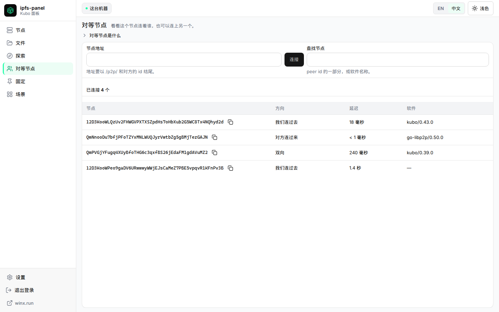
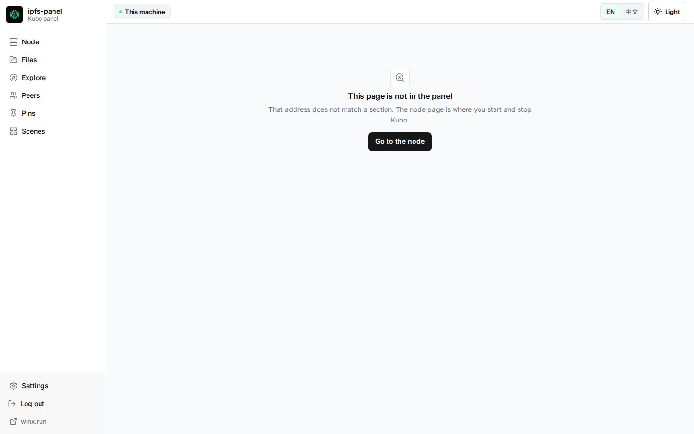

# Design system

**English** · [中文](DESIGN-SYSTEM.zh-CN.md)

This is the visual foundation for **ipfs-panel**. The product name stays ipfs-panel. It sits under the WinX brand. **winx.run** is the front door, not a second product. The node sentences and the manager actions still come from [Node lifecycle](DESIGN-node-lifecycle.md). This file owns the chrome around them.

## What this screen is

A self-hosted open-source ops panel for one Kubo node, in the same family as 宝塔 (BaoTa) and 1Panel. Someone installs it and operates the node from a browser. It is not a SaaS marketing console, and it is not a pastel product site.

The same UI is the local seat now and the remote seat later. [Vision](VISION.md) already says that: one page, two places you can sit. Do not design a second, more "product" shell for one of them. The top bar says "This machine" while the panel is on the machine that runs Kubo. Remote use, when it exists, keeps this chrome.

Take the genre from those panels: a solid dark rail, a neutral work surface, compact tables and toolbars, one accent, status you can read without a legend. Do not copy their names, icons, illustrations, or layout pixel for pixel.

What this is not: a Vercel, Linear, or Raycast dashboard. No mint wash, no oversized title, no pill controls, no card that floats in a field of empty color. Density is the normal page, not a later expert mode. Beginners still get one sentence and one next step. They do not get a landing page.

## Brand

The mark is the WinX hexagon from [winx-ipfs/Mirror-Web](https://github.com/winx-ipfs/Mirror-Web) `src/assets/winx.svg`, `winx-light.svg`, and `winx-dark.svg`. The in-app mark keeps that geometry and uses `currentColor`, with a heavier stroke so it still reads at 28px. The favicon is a simplified hexagon on a dark tile, drawn in the same teal as `--sidebar-accent`. The full drawing turns to noise at 16px.

The accent is a restrained teal, in the neighborhood of the IPFS cube, not a neon mint. Light theme primary is `#0e6b70`. On a dark surface the button and the mark use `#3ec4bc` with dark ink, because the light-theme teal is too dim there. `#20ffa9` is not a token. It fails as text on white, and as a button it reads as a lifestyle product.

Running is a separate green (`--success`). The accent means "do this". Green means "the node is up". They are not the same color.

## Voice

The page sounds like a tool.

- The `h1` is the section name: Node, Files, Peers. It is not a slogan.
- The line under it is one sentence about the job on this machine. It is not a pitch, and it does not welcome anyone.
- Empty states name the situation and the next action.
- Do not add an eyebrow, a hero line, or a second subtitle.
- Strings that already do this stay. Do not rewrite them for flavor. A new string lands in `en` and `zh` together, and it says the job.

## What we did not adopt

The components are in-house. CSS variables hold the tokens. Vue components in `apps/web/src/components` are thin.

Naive UI and Element Plus were set aside. They ship a second visual language and a large kit. This panel draws a small set of its own, in the ops-panel genre, without taking on their themes or markup. Restyling a kit would cost more than keeping the controls we already have.

reka-ui (Radix Vue) was the serious alternative. It would have given a focus trap and a listbox. The set here is small enough to own. The select is a native `<select>`, so a phone gets the system picker and a Chinese IME is not our problem. The dialog's focus trap is local. A headless kit stays the escape hatch if a later slice needs a real combobox. It is not a dependency today.

[Contributing](../CONTRIBUTING.md) asks for a yes before a new framework. This change does not add one.

Icons are [Lucide](https://lucide.dev) via `@lucide/vue`. Import one icon at a time so the bundle can drop the rest. Default size is 18px, stroke width 1.75. Decorative icons are `aria-hidden`. If an icon is the only content of a button, the button has an accessible name.

Runtime font requests do not go to a CDN. Latin text uses Inter, self-hosted from `@fontsource/inter` (latin 400, 500, 600, woff2). Chinese comes from the machine:

`Inter, Segoe UI, PingFang SC, Hiragino Sans GB, Noto Sans SC, Noto Sans CJK SC, Source Han Sans SC, Microsoft YaHei, WenQuanYi Zen Hei, WenQuanYi Micro Hei, sans-serif`

Mono, for the peer id and the folder path:

`ui-monospace, SFMono-Regular, Cascadia Mono, Sarasa Mono SC, Noto Sans Mono CJK SC, PingFang SC, Microsoft YaHei, monospace`

## Color

Tokens live in `apps/web/src/styles/tokens.css` on `:root`, and again under `:root[data-theme="dark"]`. Names are semantic. Do not use a raw hex in a component. `apps/web/src/stores/theme.ts` and the script in `index.html` copy `--bg` into `theme-color`, because that script runs before CSS.

The canvas is a cool neutral gray. The sidebar is its own charcoal in both themes, darker than the canvas in the dark theme so the rail still separates. Surfaces are white in the light theme and a lifted neutral in the dark theme. There is no green in the canvas, the border, or the muted text.

| Token | Light | Dark | Use |
| --- | --- | --- | --- |
| `--bg` | `#e8ebf0` | `#12161b` | Page canvas |
| `--surface` | `#ffffff` | `#1b2128` | Cards, top bar, dialogs |
| `--surface-sunken` | `#f4f6f8` | `#151a20` | Wells, table heads, badges |
| `--border` | `#d5dbe3` | `#2e3741` | Hairlines |
| `--border-strong` | `#b4bdca` | `#42505c` | Inputs, quiet buttons |
| `--text` | `#1b2128` | `#e8eef3` | Body |
| `--muted` | `#4e5966` | `#b0bac4` | Secondary text |
| `--primary` | `#0e6b70` | `#3ec4bc` | The one accent, and primary buttons |
| `--primary-ink` | `#ffffff` | `#062421` | Text on a primary button |
| `--primary-soft` | `#e5f3f3` | `#163431` | Selected chips, soft fills in the workspace |
| `--mark` | `#0e6b70` | `#3ec4bc` | The mark on a light or dark surface |
| `--success` / `--success-soft` | `#0e7a42` / `#e6f4ec` | `#3dbe86` / `#143028` | Running |
| `--warning` / `--warning-soft` | `#8a5a00` / `#fff4d6` | `#f5c16c` / `#3a2c12` | Stopping, unreachable |
| `--danger` / `--danger-soft` | `#b42318` / `#fdeceb` | `#ffb4ab` / `#3a1c1a` | Needs attention |
| `--info` / `--info-soft` | `#0f5c86` / `#e7f2f8` | `#9fd4f5` / `#122833` | Starting |
| `--neutral` / `--neutral-soft` | `#4e5966` / `#e8ecf1` | `#c5ced6` / `#2a323a` | Stopped |
| `--focus` | `#0e6b70` | `#3ec4bc` | Focus ring on the workspace |
| `--sidebar` | `#1a2129` | `#0e1216` | Rail and the narrow-screen drawer |
| `--sidebar-text` | `#e8edf2` | `#e8edf2` | Rail labels |
| `--sidebar-muted` | `#b4bec8` | `#b4bec8` | Rail secondary text |
| `--sidebar-hover` | `#262f39` | `#1c242c` | Rail hover |
| `--sidebar-active` | `#1d3336` | `#163033` | Selected section |
| `--sidebar-active-text` | `#e8fffc` | `#e8fffc` | Selected section label |
| `--sidebar-accent` | `#3ec4bc` | `#3ec4bc` | Rail mark, selected bar, favicon stroke |
| `--sidebar-focus` | `#8ee8e0` | `#8ee8e0` | Focus ring on the rail |

Text and muted text are at least 4.5:1 on `--bg`, `--surface`, `--surface-sunken`, and the soft fills they sit on. Primary button ink is at least 4.5:1 on `--primary`. The status badge uses the same rule against its soft fill. Rail text and rail muted text are at least 4.5:1 on `--sidebar`, `--sidebar-hover`, and `--sidebar-active`.

Node state colors, always with a word, never color alone:

| Situation | Tone |
| --- | --- |
| `down` | neutral |
| `starting` | info, dot pulses |
| `up` | success |
| `stopping` | warning, dot pulses |
| `failed` | danger |
| manager unreachable | warning |

Stopped is not an error. Stopping is not a failure. The primary button stays the accent. It is not red. Red means the node needs attention.

## Type, space, radius, shadow, motion

Body text is 14px. That is the size a Chinese ops panel is read at, and Inter at 14px still has a real weight range. Do not drop the body to 12px to look dense.

| Token | Value |
| --- | --- |
| `--text-xs` | 0.75rem (12px) |
| `--text-sm` | 0.8125rem (13px) |
| `--text-md` | 0.875rem (14px) |
| `--text-lg` | 1rem (16px) |
| `--text-xl` | 1.125rem (18px) |
| `--text-2xl` | 1.25rem (20px) |
| `--leading-body` | 1.5 |
| `--space-1` … `--space-12` | 4, 8, 12, 16, 20, 24, 32, 40, 48 |
| `--radius-sm` / `md` / `lg` | 4 / 6 / 8 |
| `--radius-full` | 999px |
| `--shadow-sm` | a 1px hairline lift on a card |
| `--shadow-md` | a dialog or menu, enough to separate it from the page |
| `--duration-fast` / `--duration` | 120ms / 180ms |
| `--ease` | `cubic-bezier(0.2, 0, 0, 1)` |

The page title uses `--text-2xl` (20px). The node sentence uses `--text-xl` (18px). Neither uses negative tracking. Negative tracking on a short title is a marketing habit. Under `:lang(zh)` tracking stays 0. Do not tighten Chinese.

`--radius-full` is only the switch, the status dot, and the password meter. Buttons, inputs, cards, badges, toasts, menus, and the language segment use `--radius-sm` or `--radius-md`. A pill is a marketing control.

Cards separate from the canvas with a hairline and `--shadow-sm`. They do not float on a large soft shadow. Dialogs and menus use `--shadow-md`.

`prefers-reduced-motion: reduce` cuts animation and transition time to nearly nothing. The pulsing status dot and the skeleton shimmer stop. Do not add a second motion switch. The operating system already has one.

## Density

Tighter than a marketing page, looser than a 2005 control panel.

- Hit targets for actions and icon buttons stay at least 40px. Primary actions on the node card stay 44px tall. Density comes from type, radius, padding, and how much of the workspace the column uses. It does not come from shrinking a button until it is hard to hit.
- Cards pad 16px, 14px on a narrow screen.
- Table cells pad 8px by 10px. The header row uses `--surface-sunken` and 13px type. It is not uppercase and it is not letter-spaced.
- Toolbars are one row of rectangular controls. Sort and filter chips use `--radius-sm`. The selected chip uses `--primary-soft` and `--primary`.
- The page header sits 12px above the work, with 4px between the title and the one-sentence description.
- A form page is `min(920px, 100%)`, left-aligned. A list page (files, pins, peers, explore) and the scenes page are `min(1080px, 100%)`. From 1200px the node page is two columns inside `min(1080px, 100%)`. Prose stays inside about 40rem. The old 760px column left a wide empty field that read as a landing page.

## Components

All of them are in `apps/web/src/components`. Prefer these over a new one-off button.

| Component | Use |
| --- | --- |
| `Button` | `primary` is the one obvious action. `quiet` is the second action (Restart). `danger` is rare and means something hard to undo. `ghost` is for low-emphasis actions in a bar. Radius is `--radius-sm`. |
| `IconButton` | Needs a `label`. The label is the accessible name. Pair it with `Tooltip` when the name also helps sighted people. |
| `Card` | One subject on a bordered surface. Status is a `StatusPill`, not a stripe painted on the card. |
| `StatusPill` | A word plus a dot, drawn as a small badge (`--radius-sm`), not a capsule. Tones match the color table. `pulse` only for starting and stopping. |
| `Input` | Label above, hint or error below. Wire `aria-invalid` through the `error` prop. Setup, login, and change-password use it. The node page still must not grow a path field. |
| `Select` | Native select. Two or more options that should use the platform picker. Language on the Settings page. The top bar keeps a two-way segment for English / 中文, because two choices do not need a menu. The segment is rectangular. |
| `Switch` | A boolean the person can flip immediately. Theme "match this device" is the example. The track stays fully rounded. That is the control, not chrome. |
| `Tabs` | Real panels, not a radio by another name. Arrow keys move the tab. Settings uses General, Account, and About. The selected tab is an underline, not a pill. |
| `Dialog` | `dialog` for a short decision. `drawer` for the narrow-screen nav. Escape closes. Focus returns to the opener. The title is required even when it is visually hidden. The drawer uses the rail colors, same as the sidebar. |
| `Toast` | Short confirmation, `aria-live="polite"`. "Copied" is the one we show. Rectangular, not a pill. |
| `Tooltip` | Extra name on hover and focus. Do not hide the only copy of a required sentence in a tooltip. |
| `Skeleton` | The shape of the card while the first overview is in flight. Not a spinner on a blank page. |
| `EmptyState` | A title, one or two sentences, one next step. 404 and a blocked section. The icon tile is 40px with `--radius-sm`. |
| `PageHeader` | One `h1` per page, the section name, plus one sentence about the job. |
| `Table` | Rows of facts or a short record. Put a caption on it. `plain` is for a card. The default is for a record like the About table. Stack the plain table on narrow screens so a peer id is not squeezed into a third column. |
| `BrandMark` | The adapted WinX mark. Do not recolor it outside `--mark` on a surface, or `--sidebar-accent` on the rail. |

Rules:

- One primary button in a group. Restart stays quiet, and only while the node is up.
- Do not invent a sixth node state. Restart is stop, then start.
- Do not show a Kubo RPC address, or port 5001. The files page may copy a local gateway link. The label says it only works on this computer.
- Placeholder sections say they are not built yet, in both languages, and offer a way back to the node. They do not render fake files or fake pins.

## Empty, loading, error

| Moment | What the page does |
| --- | --- |
| First load, no snapshot yet | Skeleton. The status text is "Loading the node status." It is not "The node is stopped." |
| `starting` or `stopping` | The sentence, a hint that the page updates on its own, no manager buttons. |
| `failed` | The translated sentence for `error.code`. `error.detail`, when present, sits in a preformatted well labeled Details. It is not the sentence. |
| Manager request failed | The unreachable sentence, the last snapshot kept, Retry as the only manager action. |
| Section not built | Empty state, Soon in the nav, no disabled item that cannot be opened. |
| Unknown URL | 404 with one action back to the node. The router does not silently redirect. |

## Accessibility

- Body text, muted text, and button ink meet WCAG AA (4.5:1). The focus ring is 2px, offset 2px, and uses `:focus-visible` so a mouse click does not leave a ring.
- On the workspace the ring is `--focus`. On the rail and the drawer it is `--sidebar-focus`, because the workspace teal disappears on charcoal.
- The first control is "Skip to content".
- The narrow-screen nav is a dialog: labelled, modal, Escape to close, focus trapped, focus restored. It is the same dark rail as the sidebar.
- Tabs use `tab`, `tablist`, and `tabpanel`. The switch uses `role="switch"` and `aria-checked`.
- Status is a sentence in a `role="status"` element, plus the badge. The badge is not the only carrier.
- `html lang` is `en` or `zh-Hans`, from the locale store.
- Hit targets for actions and icon buttons are at least 40px. Primary actions on the node card are 44px tall.

## Layout and the two languages

- A new string lands in `apps/web/src/locales/en.ts` and `zh.ts` in the same change. `zh` is Simplified Chinese.
- Do not ellipsize a sentence, a button label, a peer id, a path, or an error. Wrapping is the layout. A long detail block may scroll inside its well. The text is still in the page.
- Folder paths get a break opportunity after each `/`. Peer ids have no breaks in them, so they wrap anywhere.
- Buttons may grow and wrap onto a second line. Do not fix their width in `ch` of the English word. Chinese labels are often shorter. English hints are often longer.
- The sidebar labels wrap instead of clipping. Node, Files, Explore, Peers, Pins, and Scenes are normal items. Settings sits at the bottom of that list, then the footer.

## Shell

- Sidebar from 880px up, 220px wide, charcoal in both themes. Below that, a menu button opens the drawer, and the drawer is the same rail.
- The selected section has a teal bar on the inline-start edge and `--sidebar-active` behind the label. Hover is a lighter charcoal, not a white pill.
- The rail does not scroll away on a long page. It stays `100vh`.
- Top bar: a white (or dark-surface) strip with a hairline under it, 48px at rest. It holds "This machine", the English / 中文 segment, and a theme button. The button cycles light, dark, and match-device. Its icon and, from 720px up, its label show the current mode. The accessible name and the tooltip say the same mode. Both choices persist in `localStorage` (`ipfs-panel.lang`, `ipfs-panel.theme`). The theme is applied from a small script in `index.html` before paint, so the first frame is not the wrong theme. The segment and the theme button are rectangular. They do not float as pills.
- From 1200px the node page is two columns. The status card is on the left. On the right, while the node is up, a Connection card shows the version and a shortened peer id. The copy button copies the full peer id. The overview does not include a gateway address or an API address, so the card does not invent them. Otherwise the right card explains what a node is and links to the IPFS docs.
- Nav: Node, Files, Explore, Peers, Pins, Scenes, then Settings. Those are real pages. Expert mode is not a nav item.
- `winx.run` sits in the sidebar footer, under Sign out. It opens in a new tab. It is the portal, labeled as such.
- Login and first-run setup use the same canvas and the same card. There is no glow behind the mark. The mark tile is 48px.

Dev-only, the node page reads `?mock=` when `import.meta.env.DEV` is true: `down`, `starting`, `up`, `stopping`, `failed`, or `unreachable`. The production bundle does not include those fixtures. The Vite proxy to the manager is unchanged.

## Screenshots

From `apps/web`, after `npx playwright install chromium`:

```bash
npm run shots
```

That writes the node page in all five states, the files page (list, empty, uploading, delete dialog, node stopped), the explore page (start, and a block with links), the peers page (list, empty, node stopped), the pins page (list, add dialog with a validation error, a job in progress, empty), the scenes page (list, preview, applied), the setup screen, the login screen with an error, and the settings password form, light and dark, English and 中文, at 1440 and 390, plus the 404 page, to `SHOTS_DIR` or `/opt/cursor/artifacts`. The script starts Vite itself. It does not need a running manager. Auth screens use a dev-only `?auth=` fixture. The files page uses `?files=`. The explore page uses `?explore=`. The peers page uses `?peers=`. The pins page uses `?pins=`. The scenes page uses `?scenes=`.

This is not a CI job. A Chromium install and the machine's CJK fonts make a pixel run slow and easy to flake, and `ci-ok` should stay the fast check. The unit tests still cover the sentences, the manager actions, and the form controls. Re-run `npm run shots` when the shell or the node card changes, and look at the pictures.





