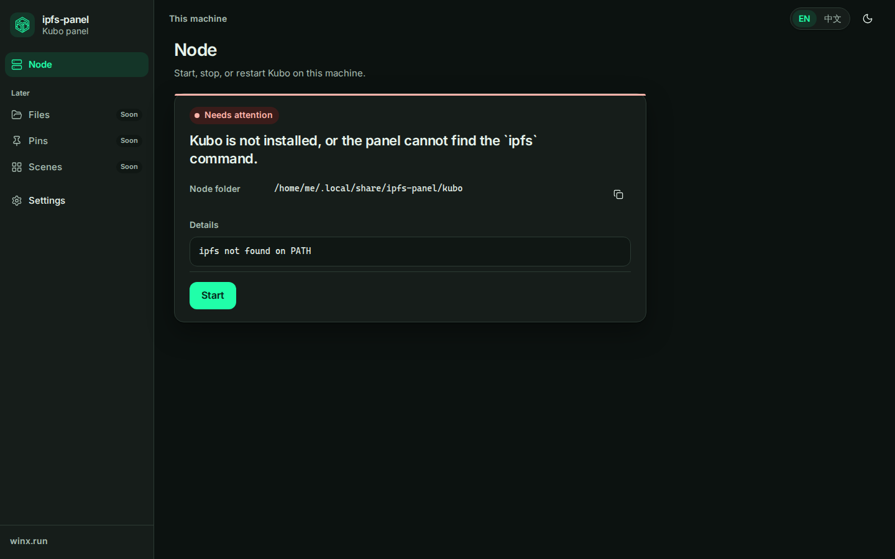
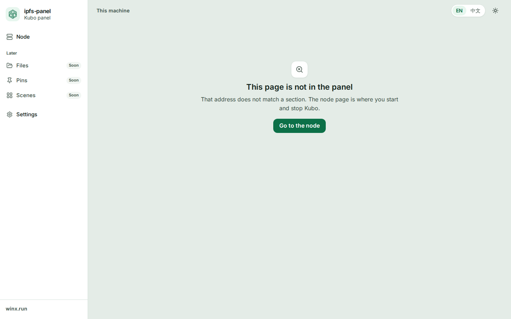

# 设计系统

[English](DESIGN-SYSTEM.md) · **中文**

这是 **ipfs-panel** 的视觉地基。产品名仍是 ipfs-panel。它在 WinX 这个牌子下面。**winx.run** 是门口，不是另一个产品。节点的那句话和管理动作仍以[节点启停](DESIGN-node-lifecycle.zh-CN.md)为准。本文管的是周围的界面。

## 品牌

安静、直白、带一点绿。参照是 1Panel、Vercel 的仪表盘、Linear、Raycast、Tailscale 的管理页：大片安静的底，一个强调色，状态不用图例也能读懂。第一批画面的使用者里有新手，所以页面留白。密度以后可以出现在专家模式里，不出现在首页这张卡片上。

标志用的是 WinX 的六边形，来自 [winx-ipfs/Mirror-Web](https://github.com/winx-ipfs/Mirror-Web) 的 `src/assets/winx.svg`、`winx-light.svg`、`winx-dark.svg`。面板里的标志保留这套几何，描边用 `currentColor`，并且加粗，这样 28px 时还看得清。favicon 是深色底上一个简化的六边形。原图缩到 16px 会糊成一团。

品牌绿是 `#20ffa9`。深色底上，它是主按钮，也是标志的颜色。它铺在白底上大约只有 1.3:1，所以浅色主题里不用它做文字或按钮。浅色主题的主色是 `#0c7048`。

## 没有采用的库

组件是自己写的。令牌是 CSS 变量。`apps/web/src/components` 里的 Vue 组件保持薄。

Naive UI 和 Element Plus 先不用。它们自带另一套视觉，而且偏密的管理后台。那和这个页面要的方向相反。为了改掉那套样子，成本比自己画这一小组件更高。

reka-ui（Radix Vue）是认真考虑过的。它能提供焦点圈定和列表框。现在这一组控件很小，自己拿得住。下拉用的是原生 `<select>`，手机上会出系统自己的选择器，中文输入法也不是我们要重做的东西。对话框的焦点圈定写在本地。以后某一片真的需要组合框，无头组件库仍是退路。现在不依赖它。

[参与方式](../CONTRIBUTING.zh-CN.md) 要求新框架先得到同意。这次没有加框架。

图标用 [Lucide](https://lucide.dev)，包是 `@lucide/vue`。一次只引入要用的那个，剩下的才能从包里丢掉。默认 18px，线宽 1.75。装饰性图标加 `aria-hidden`。按钮里只有图标时，按钮要有可访问的名字。

运行时不向 CDN 要字体。拉丁字母用 Inter，从 `@fontsource/inter` 自己带上（latin 的 400、500、600，woff2）。中文用这台机器上的字体：

`Inter, Segoe UI, PingFang SC, Hiragino Sans GB, Noto Sans SC, Noto Sans CJK SC, Source Han Sans SC, Microsoft YaHei, WenQuanYi Zen Hei, WenQuanYi Micro Hei, sans-serif`

等宽字体用来排 Peer ID 和文件夹路径：

`ui-monospace, SFMono-Regular, Cascadia Mono, Sarasa Mono SC, Noto Sans Mono CJK SC, PingFang SC, Microsoft YaHei, monospace`

## 颜色

令牌在 `apps/web/src/styles/tokens.css` 的 `:root` 上，深色在 `:root[data-theme="dark"]`。名字是语义。组件里不要写裸的十六进制。

| 令牌 | 浅色 | 深色 | 用途 |
| --- | --- | --- | --- |
| `--bg` | `#e4ece7` | `#0c1210` | 页面底 |
| `--surface` | `#ffffff` | `#161d1a` | 卡片、侧栏、对话框 |
| `--surface-sunken` | `#f2f6f3` | `#101714` | 下凹的块、详情、徽章 |
| `--border` | `#d5e0d9` | `#2c3b34` | 细线 |
| `--border-strong` | `#b7c6bd` | `#3e5248` | 输入框、次按钮 |
| `--text` | `#13241c` | `#e7f3ec` | 正文 |
| `--muted` | `#3e5248` | `#a8bdb3` | 次要文字 |
| `--primary` | `#0c7048` | `#20ffa9` | 唯一的强调色，以及主按钮 |
| `--primary-ink` | `#ffffff` | `#05281a` | 主按钮上的字 |
| `--primary-soft` | `#e7f6ee` | `#143528` | 选中的导航、浅底 |
| `--success` / `--success-soft` | `#0c7048` / `#e7f6ee` | `#3ee6a4` / `#143528` | 正在运行 |
| `--warning` / `--warning-soft` | `#8a5a00` / `#fff4d6` | `#f5c16c` / `#3a2c12` | 正在停止、连不上 |
| `--danger` / `--danger-soft` | `#b42318` / `#fdeceb` | `#ffb4ab` / `#3a1c1a` | 需要处理 |
| `--info` / `--info-soft` | `#0f5c86` / `#e7f2f8` | `#9fd4f5` / `#122833` | 正在启动 |
| `--neutral` / `--neutral-soft` | `#3e5248` / `#e7eeea` | `#d5e4dc` / `#24302b` | 已停止 |
| `--focus` | `#0c7048` | `#20ffa9` | 焦点环 |

正文和次要文字在 `--bg`、`--surface` 以及它们所在的浅底上至少 4.5:1。主按钮的字在 `--primary` 上至少 4.5:1。状态胶囊和它的浅底也按这条。

节点状态的颜色永远配一个词，不能只靠颜色：

| 情况 | 色调 |
| --- | --- |
| `down` | 中性 |
| `starting` | 信息色，圆点会轻跳 |
| `up` | 成功 |
| `stopping` | 警告，圆点会轻跳 |
| `failed` | 危险 |
| 连不上管理服务 | 警告 |

已停止不是错误。正在停止也不是失败。主按钮保持强调色，不用红色。红色表示节点需要处理。

## 字号、间距、圆角、阴影、动效

| 令牌 | 值 |
| --- | --- |
| `--text-xs` | 0.75rem |
| `--text-sm` | 0.875rem |
| `--text-md` | 1rem |
| `--text-lg` | 1.125rem |
| `--text-xl` | 1.375rem |
| `--text-2xl` | 1.75rem |
| `--leading-body` | 1.6 |
| `--space-1` … `--space-12` | 4、8、12、16、20、24、32、40、48 |
| `--radius-sm` / `md` / `lg` | 8 / 12 / 16 |
| `--radius-full` | 999px |
| `--shadow-sm` | 1px 的抬起 |
| `--shadow-md` | 抬起再加一层软阴影，白卡片才分得开底色 |
| `--duration-fast` / `--duration` | 120ms / 180ms |
| `--ease` | `cubic-bezier(0.2, 0, 0, 1)` |

拉丁字母的标题略收字距。`:lang(zh)` 下字距是 0。不要去挤中文。

`prefers-reduced-motion: reduce` 时，动画和过渡几乎关掉。状态圆点的跳动和骨架的闪光都会停。不要再做一个「减少动效」开关。操作系统里已经有了。

## 组件

都在 `apps/web/src/components`。优先用这些，不要另写一个一次性的按钮。

| 组件 | 用法 |
| --- | --- |
| `Button` | `primary` 是那一个明显的动作。`quiet` 是第二个（重启）。`danger` 很少用，表示很难撤销的事。`ghost` 给工具条上不强调的动作。 |
| `IconButton` | 必须有 `label`。这个 label 就是可访问的名字。需要让看得见的人也读到时，配 `Tooltip`。 |
| `Card` | 一件事一张卡。`tone` 画一条 3px 的状态条。`none` 是普通卡片。 |
| `StatusPill` | 一个词加一个圆点。色调和上面的表一致。`pulse` 只给正在启动和正在停止。 |
| `Input` | 标签在上，说明或错误在下。错误走 `error`，会带上 `aria-invalid`。设置、登录和改密码用它。节点页仍然不能长出路径输入框。 |
| `Select` | 原生下拉。两个以上、适合用系统选择器的选项。设置页上的语言用它。顶栏的英文 / 中文仍是两段切换，两个选项不必再套一层菜单。 |
| `Switch` | 可以马上翻转的布尔值。主题里的「跟这台设备一致」就是例子。 |
| `Tabs` | 真正的面板，不是换了名字的单选。方向键移动。设置页是「通用」、「账号」和「关于」。 |
| `Dialog` | `dialog` 给一个短决定。`drawer` 给窄屏导航。Escape 关闭。焦点回到打开它的控件。标题必须有，哪怕视觉上藏起来。 |
| `Toast` | 短确认，`aria-live="polite"`。现在用来显示「已复制」。 |
| `Tooltip` | 悬停和焦点时多给一个名字。一句必须读到的话，不要只放在提示里。 |
| `Skeleton` | 第一次概览还在路上时，画出卡片的形状。不要在空白页上放一个转圈。 |
| `EmptyState` | 标题、一两句说明、一个下一步。404 和还没做的栏目用它。 |
| `PageHeader` | 每页一个 `h1`，再加上这页是干什么的。 |
| `Table` | 几行事实，或一份短记录。要有 caption。`plain` 用在卡片里。默认样式给「关于」那种记录。窄屏上 plain 表格改成上下排，避免 Peer ID 被挤进第三列。 |
| `BrandMark` | 改过的 WinX 标志。不要在 `--mark` 之外给它上色。 |

规矩：

- 一组里只有一个主按钮。重启保持次要，而且只在节点运行时出现。
- 不要发明第六个节点状态。重启就是先停再启动。
- 不显示 Kubo RPC 地址，也不出现 5001 端口。文件页可以复制一条本机网关链接。文案说明它只在这台电脑上有效。
- 占位栏目用两种语言写明还没做，并给一条回到节点的路。不要画假的文件或假的 pin。

## 空、加载、错误

| 时刻 | 页面做什么 |
| --- | --- |
| 第一次加载，还没有快照 | 骨架。状态文字是「正在读取节点状态。」不是「节点已停止。」 |
| `starting` 或 `stopping` | 那一句说明，加上页面会自己更新的提示。没有管理动作按钮。 |
| `failed` | 按 `error.code` 翻译的那一句。`error.detail` 非空时，放在标了「详情」的预格式块里。它不是那句给新手看的话。 |
| 请求管理服务失败 | 连不上的那一句。保留上一份快照。管理动作只剩重试。 |
| 栏目还没做 | 空状态。导航上标「即将」。不要做成打不开的禁用项。 |
| 未知地址 | 404，一个动作回到节点。路由不悄悄跳转。 |

## 无障碍

- 正文、次要文字、按钮上的字达到 WCAG AA（4.5:1）。焦点环 2px，偏移 2px，用 `:focus-visible`，鼠标点一下不会留下环。
- 第一个控件是「跳到正文」。
- 窄屏导航是对话框：有名字、模态、Escape 关闭、焦点圈在里面、关上后焦点回去。
- 标签页使用 `tab`、`tablist`、`tabpanel`。开关使用 `role="switch"` 和 `aria-checked`。
- 状态是 `role="status"` 里的一句话，再加上胶囊。不能只有胶囊。
- `html lang` 由语言状态写成 `en` 或 `zh-Hans`。
- 动作和纯图标按钮的点按区域至少 40px。节点卡片上的主动作高 44px。

## 版式和两种语言

- 新的一句文案，同一次修改里写进 `apps/web/src/locales/en.ts` 和 `zh.ts`。`zh` 是简体中文。
- 句子、按钮文字、Peer ID、路径、错误，都不要省略号截断。排版用换行。很长的详情可以在自己的块里滚动。文字仍在页面里。
- 文件夹路径在每个 `/` 后面留一个可换行的位置。Peer ID 中间没有自然断点，所以允许在任意位置换行。
- 按钮可以变宽，也可以换到下一行。不要按英文单词的宽度把按钮写死。中文标签常常更短。英文说明常常更长。栏宽是 `min(760px, 100%)`，两种语言都不会在桌面上拉成一整行。
- 侧栏文字换行，不裁切。节点、文件、探索、固定、场景都是普通的一项。

## 外壳

- 880px 及以上是侧栏。更窄时，菜单按钮打开抽屉。
- 顶栏：英文 / 中文，以及一个主题按钮。按钮在浅色、深色、跟随设备之间轮换。图标在表明当前模式；720px 及以上还会写出当前模式。可访问名称和提示说的是同一个模式。两个选择都记在 `localStorage`（`ipfs-panel.lang`、`ipfs-panel.theme`）。`index.html` 里有一小段脚本，在绘制前套上主题，避免第一帧是错的主题。
- 1200px 起，节点页是两列。左边是状态卡片。节点在跑时，右边的「连接」卡片显示版本和缩短后的 Peer ID。复制按钮复制的是完整的 Peer ID。概览里没有网关地址，也没有 API 地址，所以卡片不去编造它们。其余时候，右边用一段话说明什么是节点，并链到 IPFS 文档。
- 导航：节点、文件、探索、固定、场景，然后是设置。文件、探索、固定和场景都是真正的页面。专家模式不进导航。愿景里它要等常用路径变得没劲之后再出现，不放在首页。
- `winx.run` 在侧栏底部。新标签页打开。它是门户，文案也这么说。

只在开发构建里，节点页会读 `?mock=`（`import.meta.env.DEV` 为真时）：`down`、`starting`、`up`、`stopping`、`failed` 或 `unreachable`。生产包里没有这些假数据。Vite 代理到 manager 的方式不变。

## 截图

在 `apps/web` 里，先 `npx playwright install chromium`，然后：

```bash
npm run shots
```

这会把节点页的五种状态、文件页（列表、空、上传中、删除对话框、节点停了）、探索页（开始，以及一块带链接的结果）、固定页（列表、带校验错误的添加对话框、进行中的任务、空列表）、场景页（列表、预览、已应用）、设置页、带错误的登录页、设置里的改密码，浅色和深色、英文和中文、1440 和 390 宽，再加上 404，写到 `SHOTS_DIR` 或 `/opt/cursor/artifacts`。脚本自己拉起 Vite。不需要 manager 在跑。登录相关画面用仅开发环境的 `?auth=`。文件页用 `?files=`。探索页用 `?explore=`。固定页用 `?pins=`。场景页用 `?scenes=`。

这不是 CI 任务。装 Chromium，再加上机器上的中文字体，像素对比又慢又容易抖，而 `ci-ok` 应该保持快。单元测试仍然覆盖那句话、管理动作和表单控件。外壳或节点卡片有改动时，再跑一次 `npm run shots`，看图。




