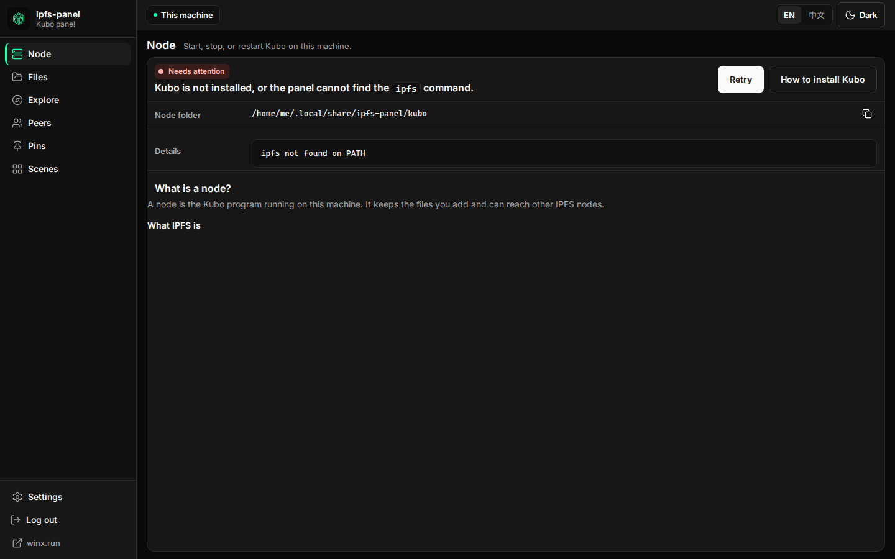
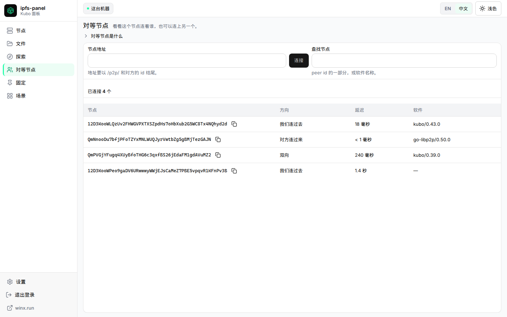
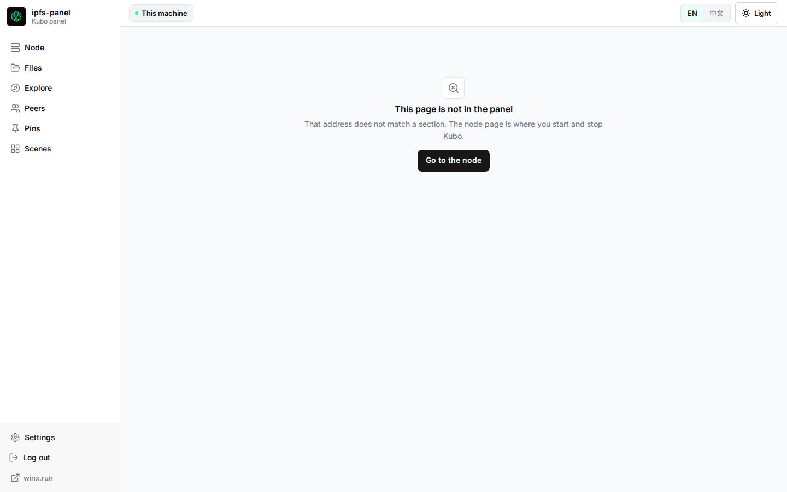

# 设计系统

[English](DESIGN-SYSTEM.md) · **中文**

这是 **ipfs-panel** 的视觉地基。产品名仍是 ipfs-panel。它在 WinX 这个牌子下面。**winx.run** 是门口，不是另一个产品。节点的那句话和管理动作仍以[节点启停](DESIGN-node-lifecycle.zh-CN.md)为准。本文管的是周围的界面。

## 这个画面是什么

一台 Kubo 节点的自托管开源运维面板，和宝塔、1Panel 是同一类东西。人把它装上，然后在浏览器里操作这台节点。它不是 SaaS 的营销控制台，也不是一张粉彩产品页。

同一套界面，现在坐在本机，以后也可以坐在远处。[愿景](VISION.zh-CN.md)已经写了：一个页面，两个座位。不要为其中一个再设计一套更像「产品」的外壳。面板就在跑 Kubo 的这台机器上时，顶栏写「这台机器」。远程使用如果出现，仍然用这套界面。

从那类面板取的是类型：一条实心的深色侧栏，一块中性的工作面，紧凑的表格和工具条，一个强调色，状态不用图例也能读懂。不要抄它们的名字、图标、插画，也不要按像素照搬版式。

这不是 Vercel、Linear 或 Raycast 那种仪表盘。不要薄荷绿的底，不要过大的标题，不要胶囊控件，不要一张卡片飘在一大片空颜色上。密度是普通页面，不是以后才在专家模式里出现的东西。新手仍然得到一句话和下一步。他们得不到一张落地页。

## 品牌

标志用的是 WinX 的六边形，来自 [winx-ipfs/Mirror-Web](https://github.com/winx-ipfs/Mirror-Web) 的 `src/assets/winx.svg`、`winx-light.svg`、`winx-dark.svg`。面板里的标志保留这套几何，描边用 `currentColor`，并且加粗，这样 28px 时还看得清。favicon 是深色底上一个简化的六边形，描边用和 `--sidebar-accent` 一样的青。原图缩到 16px 会糊成一团。

强调色是克制的青，靠近 IPFS 方块的颜色，不是霓虹薄荷。浅色主题的主色是 `#0e6b70`。深色底上，按钮和标志用 `#3ec4bc`，字用深色，因为浅色主题那支青在深底上太暗。`#20ffa9` 不是令牌。它铺在白底上做不成文字，做成按钮又像生活方式产品。

「正在运行」是另一支绿（`--success`）。强调色表示「做这件事」。绿色表示「节点在跑」。它们不是同一个颜色。

## 文案的口气

页面听起来像一件工具。

- `h1` 是栏目名：节点、文件、对等节点。不是口号。
- 标题下面一行，用一句话说这台机器上要做的事。不是推销，也不欢迎谁。
- 空状态写明现在是什么情况，以及下一步。
- 不要加眉题、主视觉那一行，或第二行副标题。
- 已经是这个口气的句子留着。不要为了换味道去改写。新的一句同时落在 `en` 和 `zh`，并且说的是这件事。

## 没有采用的库

组件是自己写的。令牌是 CSS 变量。`apps/web/src/components` 里的 Vue 组件保持薄。

Naive UI 和 Element Plus 先不用。它们自带另一套视觉，还有一大套组件。这个面板自己画一小套控件，类型是运维面板，不借用它们的主题和标记。为了改掉一套现成皮肤，成本比守住已经有的控件更高。

reka-ui（Radix Vue）是认真考虑过的。它能提供焦点圈定和列表框。现在这一组控件很小，自己拿得住。下拉用的是原生 `<select>`，手机上会出系统自己的选择器，中文输入法也不是我们要重做的东西。对话框的焦点圈定写在本地。以后某一片真的需要组合框，无头组件库仍是退路。现在不依赖它。

[参与方式](../CONTRIBUTING.zh-CN.md) 要求新框架先得到同意。这次没有加框架。

图标用 [Lucide](https://lucide.dev)，包是 `@lucide/vue`。一次只引入要用的那个，剩下的才能从包里丢掉。默认 18px，线宽 1.75。装饰性图标加 `aria-hidden`。按钮里只有图标时，按钮要有可访问的名字。

运行时不向 CDN 要字体。拉丁字母用 Inter，从 `@fontsource/inter` 自己带上（latin 的 400、500、600，woff2）。中文用这台机器上的字体：

`Inter, Segoe UI, PingFang SC, Hiragino Sans GB, Noto Sans SC, Noto Sans CJK SC, Source Han Sans SC, Microsoft YaHei, WenQuanYi Zen Hei, WenQuanYi Micro Hei, sans-serif`

等宽字体用来排 Peer ID 和文件夹路径：

`ui-monospace, SFMono-Regular, Cascadia Mono, Sarasa Mono SC, Noto Sans Mono CJK SC, PingFang SC, Microsoft YaHei, monospace`

## 颜色

令牌在 `apps/web/src/styles/tokens.css` 的 `:root` 上，深色在 `:root[data-theme="dark"]`。名字是语义。组件里不要写裸的十六进制。`apps/web/src/stores/theme.ts` 和 `index.html` 里的脚本把 `--bg` 抄进 `theme-color`，因为那段脚本跑在 CSS 之前。

页面底是冷的中性灰。侧栏在两种主题里都是自己的炭灰。深色主题里侧栏比页面底更深，这样轨道还分得开。浅色主题的表面是白，深色主题的表面是抬起一层的中性色。页面底、边框、次要文字里都没有绿。

| 令牌 | 浅色 | 深色 | 用途 |
| --- | --- | --- | --- |
| `--bg` | `#e8ebf0` | `#12161b` | 页面底 |
| `--surface` | `#ffffff` | `#1b2128` | 卡片、顶栏、对话框 |
| `--surface-sunken` | `#f4f6f8` | `#151a20` | 下凹的块、表头、徽章 |
| `--border` | `#d5dbe3` | `#2e3741` | 细线 |
| `--border-strong` | `#b4bdca` | `#42505c` | 输入框、次按钮 |
| `--text` | `#1b2128` | `#e8eef3` | 正文 |
| `--muted` | `#4e5966` | `#b0bac4` | 次要文字 |
| `--primary` | `#0e6b70` | `#3ec4bc` | 唯一的强调色，以及主按钮 |
| `--primary-ink` | `#ffffff` | `#062421` | 主按钮上的字 |
| `--primary-soft` | `#e5f3f3` | `#163431` | 工作区里选中的小块、浅底 |
| `--mark` | `#0e6b70` | `#3ec4bc` | 浅底或深底上的标志 |
| `--success` / `--success-soft` | `#0e7a42` / `#e6f4ec` | `#3dbe86` / `#143028` | 正在运行 |
| `--warning` / `--warning-soft` | `#8a5a00` / `#fff4d6` | `#f5c16c` / `#3a2c12` | 正在停止、连不上 |
| `--danger` / `--danger-soft` | `#b42318` / `#fdeceb` | `#ffb4ab` / `#3a1c1a` | 需要处理 |
| `--info` / `--info-soft` | `#0f5c86` / `#e7f2f8` | `#9fd4f5` / `#122833` | 正在启动 |
| `--neutral` / `--neutral-soft` | `#4e5966` / `#e8ecf1` | `#c5ced6` / `#2a323a` | 已停止 |
| `--focus` | `#0e6b70` | `#3ec4bc` | 工作区上的焦点环 |
| `--sidebar` | `#1a2129` | `#0e1216` | 侧栏，以及窄屏抽屉 |
| `--sidebar-text` | `#e8edf2` | `#e8edf2` | 侧栏文字 |
| `--sidebar-muted` | `#b4bec8` | `#b4bec8` | 侧栏次要文字 |
| `--sidebar-hover` | `#262f39` | `#1c242c` | 侧栏悬停 |
| `--sidebar-active` | `#1d3336` | `#163033` | 当前栏目 |
| `--sidebar-active-text` | `#e8fffc` | `#e8fffc` | 当前栏目的字 |
| `--sidebar-accent` | `#3ec4bc` | `#3ec4bc` | 侧栏标志、选中条、favicon 描边 |
| `--sidebar-focus` | `#8ee8e0` | `#8ee8e0` | 侧栏上的焦点环 |

正文和次要文字在 `--bg`、`--surface`、`--surface-sunken` 以及它们所在的浅底上至少 4.5:1。主按钮的字在 `--primary` 上至少 4.5:1。状态徽章和它的浅底也按这条。侧栏文字和侧栏次要文字在 `--sidebar`、`--sidebar-hover`、`--sidebar-active` 上至少 4.5:1。

节点状态的颜色永远配一个词，不能只靠颜色：

| 情况 | 色调 |
| --- | --- |
| `down` | 中性 |
| `starting` | 信息色，圆点会轻跳 |
| `up` | 成功 |
| `stopping` | 警告，圆点会轻跳 |
| `failed` | 危险 |
| 连不上管理服务 | 警告 |

已停止不是错误。正在停止也不是失败。主按钮保持强调色，不用红色。红色表示节点需要处理。

## 字号、间距、圆角、阴影、动效

正文 14px。中文运维面板就在这个字号上读，Inter 在 14px 也还有真正的字重。不要为了显得密，把正文降到 12px。

| 令牌 | 值 |
| --- | --- |
| `--text-xs` | 0.75rem（12px） |
| `--text-sm` | 0.8125rem（13px） |
| `--text-md` | 0.875rem（14px） |
| `--text-lg` | 1rem（16px） |
| `--text-xl` | 1.125rem（18px） |
| `--text-2xl` | 1.25rem（20px） |
| `--leading-body` | 1.5 |
| `--space-1` … `--space-12` | 4、8、12、16、20、24、32、40、48 |
| `--radius-sm` / `md` / `lg` | 4 / 6 / 8 |
| `--radius-full` | 999px |
| `--shadow-sm` | 卡片上 1px 的细抬起 |
| `--shadow-md` | 对话框或菜单，够把它从页面上分开 |
| `--duration-fast` / `--duration` | 120ms / 180ms |
| `--ease` | `cubic-bezier(0.2, 0, 0, 1)` |

页标题用 `--text-2xl`（20px）。节点那句话用 `--text-xl`（18px）。两者都不收字距。短标题上收字距是营销页的习惯。`:lang(zh)` 下字距保持 0。不要去挤中文。

`--radius-full` 只给开关、状态圆点，以及密码强度条。按钮、输入框、卡片、徽章、提示条、菜单，以及语言分段，用 `--radius-sm` 或 `--radius-md`。胶囊是营销控件。

卡片靠一条细线和 `--shadow-sm` 从底上分开。它们不靠一大块软阴影飘起来。对话框和菜单用 `--shadow-md`。

`prefers-reduced-motion: reduce` 时，动画和过渡几乎关掉。状态圆点的跳动和骨架的闪光都会停。不要再做一个「减少动效」开关。操作系统里已经有了。

## 密度

比营销页紧，比 2005 年那种控制面板松。

- 动作和纯图标按钮的点按区域仍至少 40px。节点卡片上的主动作仍高 44px。密度来自字号、圆角、内边距，以及栏目用了工作区的多少宽度。不来自把按钮缩到难点中。
- 卡片内边距 16px，窄屏 14px。
- 表格单元格内边距 8px 乘 10px。表头用 `--surface-sunken`，字号 13px。不大写，也不加字距。
- 工具条是一排矩形控件。排序和筛选小块用 `--radius-sm`。选中的小块用 `--primary-soft` 和 `--primary`。
- 页头在工作区上方 12px。标题和那一句说明之间是 4px。
- 表单页宽是 `min(920px, 100%)`，靠左。列表页（文件、固定、对等节点、探索）和场景页是 `min(1080px, 100%)`。1200px 起，节点页在 `min(1080px, 100%)` 里排成两列。正文大约守在 40rem 以内。以前那条 760px 的栏会在右边留下一大片空，读起来像落地页。

## 组件

都在 `apps/web/src/components`。优先用这些，不要另写一个一次性的按钮。

| 组件 | 用法 |
| --- | --- |
| `Button` | `primary` 是那一个明显的动作。`quiet` 是第二个（重启）。`danger` 很少用，表示很难撤销的事。`ghost` 给工具条上不强调的动作。圆角是 `--radius-sm`。 |
| `IconButton` | 必须有 `label`。这个 label 就是可访问的名字。需要让看得见的人也读到时，配 `Tooltip`。 |
| `Card` | 一件事，一块带边的表面。状态用 `StatusPill`，不在卡片上画一条色带。 |
| `StatusPill` | 一个词加一个圆点，画成小徽章（`--radius-sm`），不是胶囊。色调和上面的表一致。`pulse` 只给正在启动和正在停止。 |
| `Input` | 标签在上，说明或错误在下。错误走 `error`，会带上 `aria-invalid`。设置、登录和改密码用它。节点页仍然不能长出路径输入框。 |
| `Select` | 原生下拉。两个以上、适合用系统选择器的选项。设置页上的语言用它。顶栏的英文 / 中文仍是两段切换，两个选项不必再套一层菜单。这段切换是矩形。 |
| `Switch` | 可以马上翻转的布尔值。主题里的「跟这台设备一致」就是例子。轨道保持全圆。那是控件本身，不是外壳。 |
| `Tabs` | 真正的面板，不是换了名字的单选。方向键移动。设置页是「通用」、「账号」和「关于」。选中的是一条下划线，不是胶囊。 |
| `Dialog` | `dialog` 给一个短决定。`drawer` 给窄屏导航。Escape 关闭。焦点回到打开它的控件。标题必须有，哪怕视觉上藏起来。抽屉用和侧栏一样的颜色。 |
| `Toast` | 短确认，`aria-live="polite"`。现在用来显示「已复制」。矩形，不是胶囊。 |
| `Tooltip` | 悬停和焦点时多给一个名字。一句必须读到的话，不要只放在提示里。 |
| `Skeleton` | 第一次概览还在路上时，画出卡片的形状。不要在空白页上放一个转圈。 |
| `EmptyState` | 标题、一两句说明、一个下一步。404 和被挡住的栏目用它。图标块 40px，圆角 `--radius-sm`。 |
| `PageHeader` | 每页一个 `h1`，是栏目名，再加上一句要做的事。 |
| `Table` | 几行事实，或一份短记录。要有 caption。`plain` 用在卡片里。默认样式给「关于」那种记录。窄屏上 plain 表格改成上下排，避免 Peer ID 被挤进第三列。 |
| `BrandMark` | 改过的 WinX 标志。表面上不要在 `--mark` 之外给它上色。侧栏上用 `--sidebar-accent`。 |

规矩：

- 一组里只有一个主按钮。重启保持次要，而且只在节点运行时出现。
- 不要发明第六个节点状态。重启就是先停再启动。
- 不显示 Kubo RPC 地址，也不出现 5001 端口。文件页可以复制一条本机网关链接。文案说明它只在这台电脑上有效。
- 占位栏目用两种语言写明还没做，并给一条回到节点的路。不要画假的文件或假的 pin。

## 空、加载、错误

| 时刻 | 页面做什么 |
| --- | --- |
| 第一次加载，还没有快照 | 骨架。状态文字是「正在读取节点状态。」不是「节点已停止。」 |
| `starting` 或 `stopping` | 那一句说明，加上页面会自己更新的提示。没有管理动作按钮。 |
| `failed` | 按 `error.code` 翻译的那一句。`error.detail` 非空时，放在标了「详情」的预格式块里。它不是那句给新手看的话。 |
| 请求管理服务失败 | 连不上的那一句。保留上一份快照。管理动作只剩重试。 |
| 栏目还没做 | 空状态。导航上标「即将」。不要做成打不开的禁用项。 |
| 未知地址 | 404，一个动作回到节点。路由不悄悄跳转。 |

## 无障碍

- 正文、次要文字、按钮上的字达到 WCAG AA（4.5:1）。焦点环 2px，偏移 2px，用 `:focus-visible`，鼠标点一下不会留下环。
- 工作区上的环是 `--focus`。侧栏和抽屉上的环是 `--sidebar-focus`，因为工作区那支青在炭灰上会消失。
- 第一个控件是「跳到正文」。
- 窄屏导航是对话框：有名字、模态、Escape 关闭、焦点圈在里面、关上后焦点回去。它和侧栏是同一条深色轨道。
- 标签页使用 `tab`、`tablist`、`tabpanel`。开关使用 `role="switch"` 和 `aria-checked`。
- 状态是 `role="status"` 里的一句话，再加上徽章。不能只有徽章。
- `html lang` 由语言状态写成 `en` 或 `zh-Hans`。
- 动作和纯图标按钮的点按区域至少 40px。节点卡片上的主动作高 44px。

## 版式和两种语言

- 新的一句文案，同一次修改里写进 `apps/web/src/locales/en.ts` 和 `zh.ts`。`zh` 是简体中文。
- 句子、按钮文字、Peer ID、路径、错误，都不要省略号截断。排版用换行。很长的详情可以在自己的块里滚动。文字仍在页面里。
- 文件夹路径在每个 `/` 后面留一个可换行的位置。Peer ID 中间没有自然断点，所以允许在任意位置换行。
- 按钮可以变宽，也可以换到下一行。不要按英文单词的宽度把按钮写死。中文标签常常更短。英文说明常常更长。
- 侧栏文字换行，不裁切。节点、文件、探索、对等节点、固定、场景都是普通的一项。设置在这列的底部，然后是页脚。

## 外壳

- 880px 及以上是侧栏，宽 220px，两种主题都是炭灰。更窄时，菜单按钮打开抽屉，抽屉就是同一条轨道。
- 当前栏目在行首有一条青，标签背后是 `--sidebar-active`。悬停是更浅一层的炭灰，不是一颗白胶囊。
- 长页面上侧栏不跟着滚走。它保持 `100vh`。
- 顶栏：一条白（或深色表面）的带子，下面一条细线，静止时 48px。上面是「这台机器」、英文 / 中文分段，以及一个主题按钮。按钮在浅色、深色、跟随设备之间轮换。图标表明当前模式；720px 及以上还会写出当前模式。可访问名称和提示说的是同一个模式。两个选择都记在 `localStorage`（`ipfs-panel.lang`、`ipfs-panel.theme`）。`index.html` 里有一小段脚本，在绘制前套上主题，避免第一帧是错的主题。分段和主题按钮是矩形。它们不做成飘着的胶囊。
- 1200px 起，节点页是两列。左边是状态卡片。节点在跑时，右边的「连接」卡片显示版本和缩短后的 Peer ID。复制按钮复制的是完整的 Peer ID。概览里没有网关地址，也没有 API 地址，所以卡片不去编造它们。其余时候，右边用一段话说明什么是节点，并链到 IPFS 文档。
- 导航：节点、文件、探索、对等节点、固定、场景，然后是设置。这些都是真正的页面。专家模式不进导航。
- `winx.run` 在侧栏底部，退出登录下面。新标签页打开。它是门户，文案也这么说。
- 登录和首次设置用同一块页面底、同一张卡片。标志后面没有光晕。标志块是 48px。

只在开发构建里，节点页会读 `?mock=`（`import.meta.env.DEV` 为真时）：`down`、`starting`、`up`、`stopping`、`failed` 或 `unreachable`。生产包里没有这些假数据。Vite 代理到 manager 的方式不变。

## 截图

在 `apps/web` 里，先 `npx playwright install chromium`，然后：

```bash
npm run shots
```

这会把节点页的五种状态、文件页（列表、空、上传中、删除对话框、节点停了）、探索页（开始，以及一块带链接的结果）、对等节点页（列表、空、节点停了）、固定页（列表、带校验错误的添加对话框、进行中的任务、空列表）、场景页（列表、预览、已应用）、设置页、带错误的登录页、设置里的改密码，浅色和深色、英文和中文、1440 和 390 宽，再加上 404，写到 `SHOTS_DIR` 或 `/opt/cursor/artifacts`。脚本自己拉起 Vite。不需要 manager 在跑。登录相关画面用仅开发环境的 `?auth=`。文件页用 `?files=`。探索页用 `?explore=`。对等节点页用 `?peers=`。固定页用 `?pins=`。场景页用 `?scenes=`。

这不是 CI 任务。装 Chromium，再加上机器上的中文字体，像素对比又慢又容易抖，而 `ci-ok` 应该保持快。单元测试仍然覆盖那句话、管理动作和表单控件。外壳或节点卡片有改动时，再跑一次 `npm run shots`，看图。






